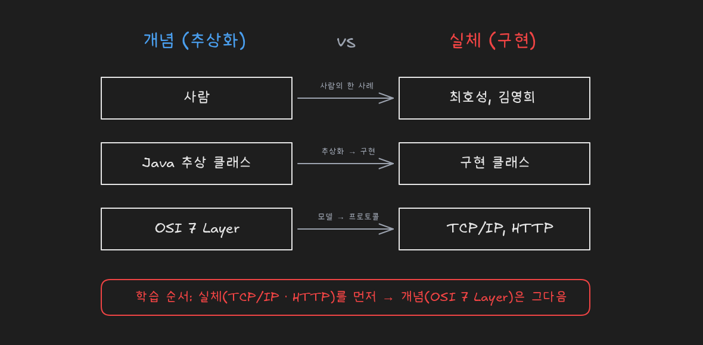
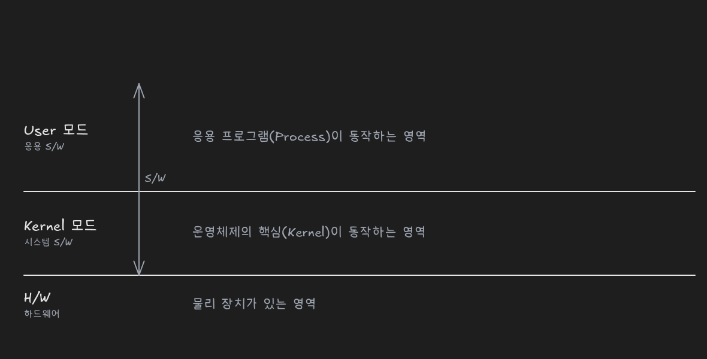
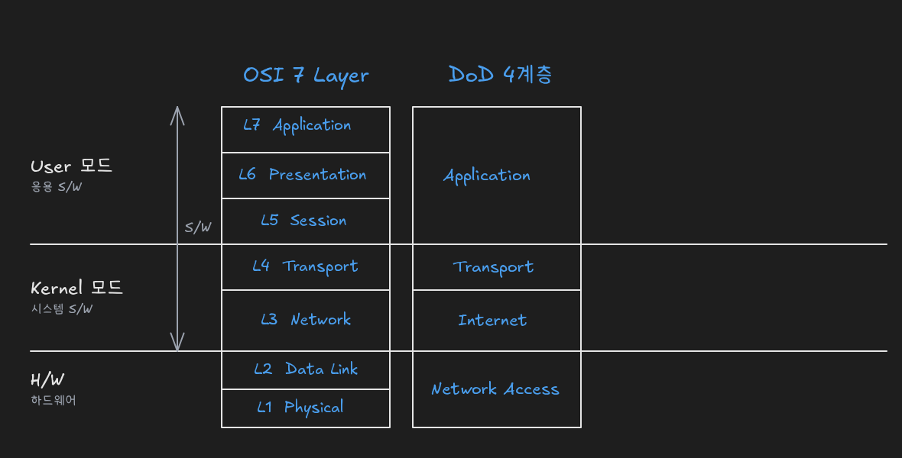
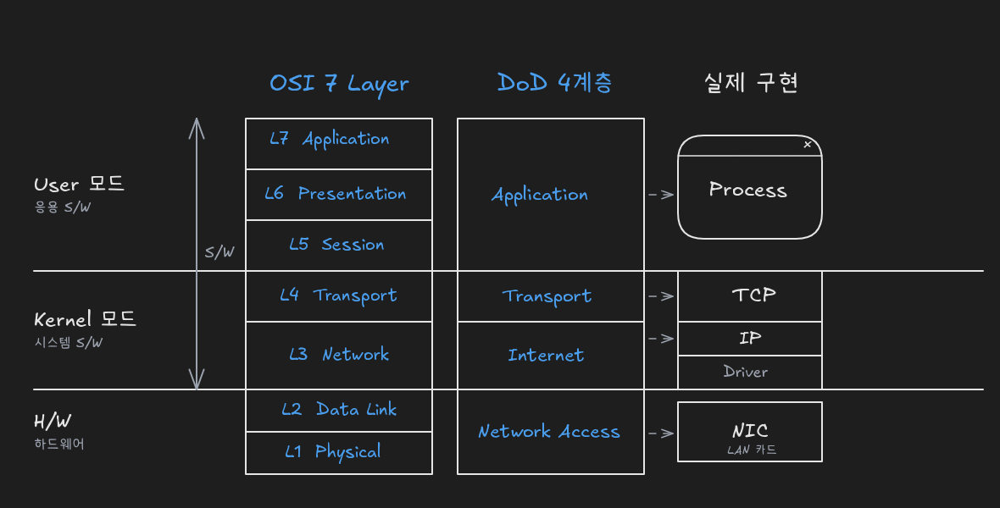
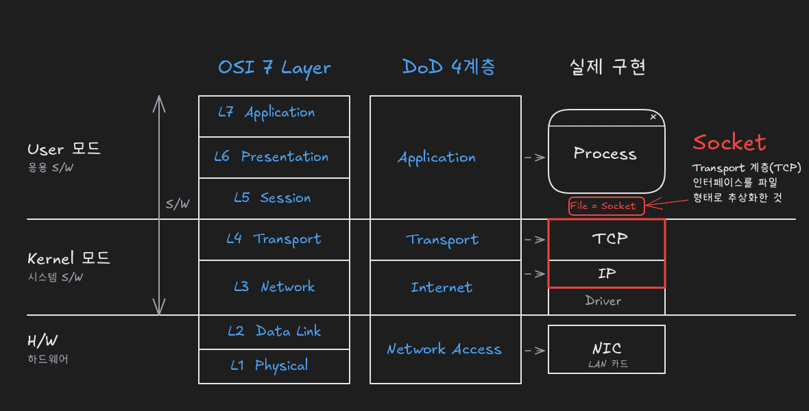
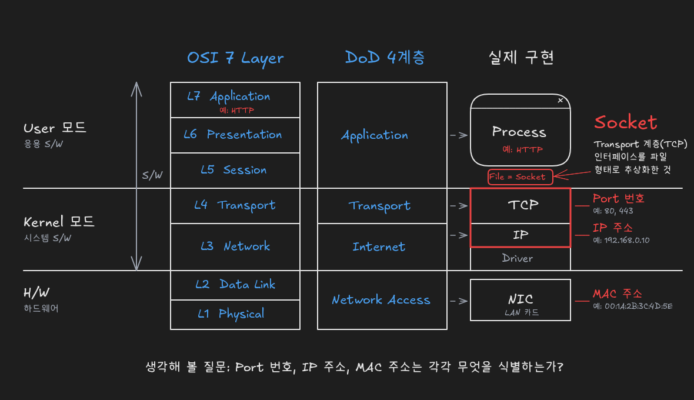

# 네트워크 학습의 출발점: OSI 7 Layer, DoD 4계층, TCP/IP 구현 구조

> 출처: [네트워크를 배우려는 사람들을 위해 (YouTube)](https://www.youtube.com/watch?v=k1gyh9BlOT8)

## 개념과 실체: 추상화와 구현

네트워크 공부를 시작하면 가장 먼저 만나는 것이 **OSI 7 Layer**입니다. OSI 7 Layer는 **완전히 개념적인 것**이므로 처음부터 깊게 파고들 대상이 아니며, 그 이유는 **개념**(concept)과 **실체**(practical)를 구분하면 분명해집니다.

개념과 실체는 다른 말로 **추상화**(abstraction)와 **구현**(implementation)이라고 부릅니다. Java의 추상 클래스와 구현 클래스의 관계와 같습니다. 예를 들어 '**사람**'은 개념이고, '**최호성**'과 '**김영희**'는 각각 '사람'에 속하는 실체입니다. 두 사람 모두 '사람'이라는 개념이 구체화된 것이며, 이를 **이상(ideal)의 실체**라고 표현할 수 있습니다.

이 관계를 네트워크에 대응시키면 다음과 같습니다.

| 구분 | 개념(추상화) | 실체(구현) |
|---|---|---|
| 사람 예시 | 사람 | 최호성, 김영희 |
| 네트워크 | **OSI 7 Layer** | **TCP/IP, HTTP** |

네트워크를 공부하는 목적은 **TCP/IP와 HTTP를 통해 인터넷이 실제로 동작하는 원리를 이해하는 것**입니다. 최호성이라는 사람과 친구가 되고 싶다면 '인류'라는 개념이 아니라 그 사람이 좋아하는 음식, 원하는 선물, 좋아하는 영화 같은 **구체적인 모습**을 알아야 합니다. 관계가 충분히 깊어진 뒤에야 "인간이란 무엇인가" 같은 철학적인 이야기를 나눌 수 있습니다. 네트워크도 마찬가지로 **실체인 TCP/IP를 먼저 공부**하고, 개념인 OSI 7 Layer는 그 이후에 이해하는 순서가 효과적입니다. 첫 장의 OSI 7 Layer에 몰두하다 지쳐서 책을 덮는 일이 흔한 실패 패턴이기 때문입니다.

## 컴퓨터의 3계층 구조: User, Kernel, Hardware

컴퓨터 세계는 **세 개의 계층**으로 구성됩니다.

- **User 모드**: 가장 위층으로 응용 프로그램(Application)이 동작하는 영역이며, 상위 수준(high level)이라고도 합니다.
- **Kernel 모드**: 가운데 층으로 운영체제의 핵심이 동작하는 영역입니다.
- **Hardware(H/W)**: 가장 아래층의 물리 장치 영역입니다.

User 모드와 Kernel 모드를 합쳐 **소프트웨어(S/W) 영역**, 그 아래를 **하드웨어(H/W) 영역**이라고 합니다. 소프트웨어 영역은 다시 **응용 소프트웨어**(User)와 **시스템 소프트웨어**(Kernel)로 나뉩니다. 이 3계층 구조는 네트워크 계층이 실제로 어디에 구현되는지 이해하는 기준이 됩니다.

## OSI 7 Layer와 DoD 4계층의 대응

**OSI 7 Layer**는 특별한 이유가 없는 한 **컴퓨터의 3계층(User, Kernel, H/W)에 걸쳐 구현**됩니다. 맨 아래가 **L1(Physical)**, 맨 위가 **L7**(Application)이며, 그 사이에 Data Link, Network, Transport, Session, Presentation 계층이 차례로 쌓여 있습니다. 각 계층의 이름은 검색으로 쉽게 확인할 수 있으며, 핵심 구분은 **아래 3개 계층(L1~L3)이 네트워크에 해당**하고, **L4가 Transport(전송) 계층**이라는 점입니다.

같은 구조를 **미국 국방부**(DoD, Department of Defense)는 **4개 계층**으로 나눴습니다. DoD 모델은 OSI의 상위 계층(L5~L7)을 하나로 묶어 **Application**으로 두고, Transport와 Network는 OSI와 동일하게 유지하며, 아래 계층(L1~L2)을 묶어 **Access**(접근 계층)라고 부릅니다. DoD 분류를 사용하면 **외울 것이 줄어들고**, 실제 구현과 더 잘 맞아떨어지기 때문에 **더 정확한 분류 방식**입니다.

컴퓨터 3계층과 두 모델의 대응은 다음과 같습니다.

| 컴퓨터 계층 | OSI 7 Layer | DoD 4계층 | 실제 구현 |
|---|---|---|---|
| **User** | L5~L7 (Session, Presentation, Application) | **Application** | **Process** (HTTP 등) |
| **Kernel** | L4 Transport, L3 Network | **Transport**, **Network** | **TCP, IP** (프로토콜) + **Driver** |
| **H/W** | L1~L2 (Physical, Data Link) | **Access** | **NIC** (LAN 카드) |

## 실제 구현: Process, TCP/IP, Driver, NIC

DoD 4계층이 실제 시스템에서 구현되는 모습은 다음과 같습니다.

- **User 영역**에는 닫기 버튼이 있는 윈도우 GUI 프로그램 같은 **프로세스**(Process)가 있습니다.
- **Kernel 영역**에는 운영체제 수준에서 Transport 계층과 Network 계층을 구현한 프로토콜, 즉 **TCP/IP**가 있습니다. 그 아래에는 하드웨어를 제어하는 **디바이스 드라이버**(Driver)가 있습니다.
- **H/W 영역**에는 LAN 카드와 같은 **NIC**(Network Interface Card)가 있습니다.

**HTTP**는 User 영역의 프로세스에서 동작하는 프로토콜로, OSI 기준 **L7**(Application 계층)에 속합니다. 웹 개발을 공부한다면 HTTP를, 네트워크 원리를 공부한다면 OSI 7 Layer의 실제 구현인 **TCP/IP**를 공부하는 것이 핵심입니다.

## 소켓(Socket): 파일 형태로 추상화한 Transport 계층 인터페이스

운영체제는 Kernel의 구성 요소를 User 모드 응용 프로그램이 사용할 수 있도록 **파일(File)의 형태로 추상화**해서 제공합니다. 이때 Kernel에 구현된 프로토콜 중 **네트워크 계층에 속하는 구성 요소를 추상화한 파일**은 파일이라고 부르지 않고 **소켓**(Socket)이라고 부릅니다.

TCP/IP 소켓을 기준으로 소켓을 정의하면 다음과 같습니다.

> **소켓은 User 모드 응용 프로그램이 Transport 계층(TCP)에 접근할 수 있도록, Transport 계층의 인터페이스를 파일 형태로 추상화한 것입니다.**

즉 프로세스(User)는 소켓이라는 파일을 통해 Kernel의 TCP/IP에 접근하고, TCP/IP는 Driver를 거쳐 NIC(H/W)를 사용합니다. OSI 7 Layer든 DoD 4계층이든 분류 기준은 서로 다르지만, 가장 중요한 것은 **각 계층이 실제 시스템에서 어떻게 구현되는가**입니다. 특히 **소켓의 의미**는 이후 더 복잡한 네트워크 원리를 이해하는 기반이 되므로, 전체 구조(3계층, OSI와 DoD의 대응, Process–Socket–TCP/IP–Driver–NIC)를 **반드시 암기**해야 합니다.

## 계층별 식별자: MAC 주소, IP 주소, Port 번호

각 계층에는 **고유한 식별자**가 있습니다.

| DoD 계층 | 구현 | 식별자 |
|---|---|---|
| **Access** | NIC (MAC) | **MAC 주소** (하드웨어 주소) |
| **Network** | IP | **IP 주소** |
| **Transport** | TCP | **Port 번호** |

Access 계층에서는 MAC 계층의 **MAC 주소**가 식별자이며, 이는 **하드웨어(H/W) 주소**입니다. Network 계층에서는 **IP 주소**, Transport 계층의 TCP에서는 **Port 번호**가 식별자입니다.

세 가지가 모두 **식별자**라는 점을 확인했다면, 다음으로 생각할 질문은 "**각 식별자는 무엇을 식별하는가?**"입니다. Port 번호, IP 주소, MAC 주소가 각각 무엇에 대한 식별자인지 구분하는 것이 다음 학습 단계의 핵심 과제입니다.

## 복습 질문

- 네트워크를 공부할 때 OSI 7 Layer부터 깊이 파고들어야 하나요?
  - 아니요. OSI 7 Layer는 완전히 개념적인 모델이므로, 실제 구현인 TCP/IP와 HTTP를 먼저 공부하는 것이 효과적입니다. 친구가 되려면 '인류'가 아니라 그 사람의 구체적인 모습을 알아야 하듯, 인터넷의 동작 원리도 실체를 통해 먼저 이해한 뒤 개념으로 넘어가는 것이 좋습니다.
- OSI 7 Layer와 TCP/IP는 어떤 관계인가요?
  - 개념(추상화)과 실체(구현)의 관계입니다. '사람'이라는 개념에 '최호성', '김영희'라는 실체가 속하듯, OSI 7 Layer라는 개념 모델을 실제로 구현한 것이 TCP/IP와 HTTP입니다.
- 컴퓨터의 3계층은 무엇이고, 소프트웨어 영역은 어디까지인가요?
  - User, Kernel, Hardware입니다. User 모드와 Kernel 모드가 소프트웨어 영역이며, User는 응용 소프트웨어, Kernel은 시스템 소프트웨어에 해당합니다. 그 아래가 하드웨어 영역입니다.
- DoD 4계층은 OSI 7 Layer와 어떻게 다른가요?
  - 계층을 4개로 묶어 단순화한 모델입니다. OSI의 L5~L7을 Application 하나로, L1~L2를 Access 하나로 묶고, Transport와 Network는 그대로 둡니다. 외울 것이 줄고 실제 구현과 더 잘 맞기 때문에 더 정확한 분류 방식으로 평가됩니다.
- TCP/IP는 컴퓨터의 어느 계층에 구현되나요?
  - Kernel 계층입니다. 운영체제 수준에서 Transport(TCP)와 Network(IP) 계층을 프로토콜로 구현하며, 그 아래 Driver가 H/W인 NIC를 제어합니다.
- HTTP는 OSI 7 Layer의 몇 계층에 속하나요?
  - L7(Application 계층)입니다. HTTP는 User 영역의 프로세스에서 동작하며, DoD 기준으로는 Application 계층에 해당합니다.
- 소켓이란 무엇인가요?
  - User 모드 응용 프로그램이 Transport 계층(TCP)에 접근할 수 있도록 Transport 계층의 인터페이스를 파일 형태로 추상화한 것입니다. 운영체제는 Kernel 구성 요소를 파일로 추상화해 제공하는데, 네트워크 프로토콜을 추상화한 파일을 특별히 소켓이라고 부릅니다.
- 프로세스가 네트워크로 데이터를 보낼 때 거치는 구현 요소를 위에서부터 순서대로 나열하면 어떻게 되나요?
  - Process → Socket(파일) → TCP → IP → Driver → NIC입니다. Process는 User, TCP/IP와 Driver는 Kernel, NIC는 H/W에 위치합니다.
- Access, Network, Transport 계층의 식별자는 각각 무엇인가요?
  - Access는 MAC 주소, Network는 IP 주소, Transport(TCP)는 Port 번호입니다. MAC 주소는 NIC에 해당하는 하드웨어 주소입니다.
- 식별자를 공부할 때 다음으로 던져야 할 질문은 무엇인가요?
  - "각 식별자가 무엇을 식별하는가?"입니다. MAC 주소, IP 주소, Port 번호가 모두 식별자라는 사실에서 나아가, 각각이 식별하는 대상을 구분하는 것이 다음 학습 단계입니다.
