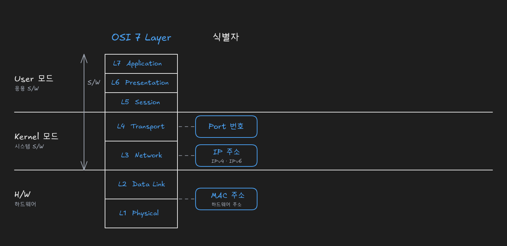
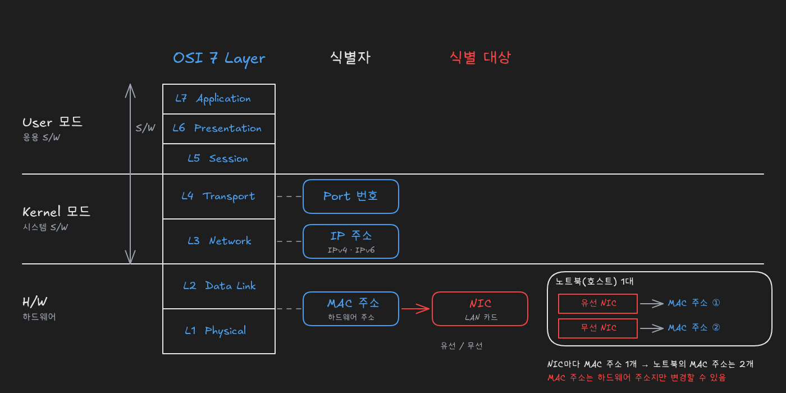
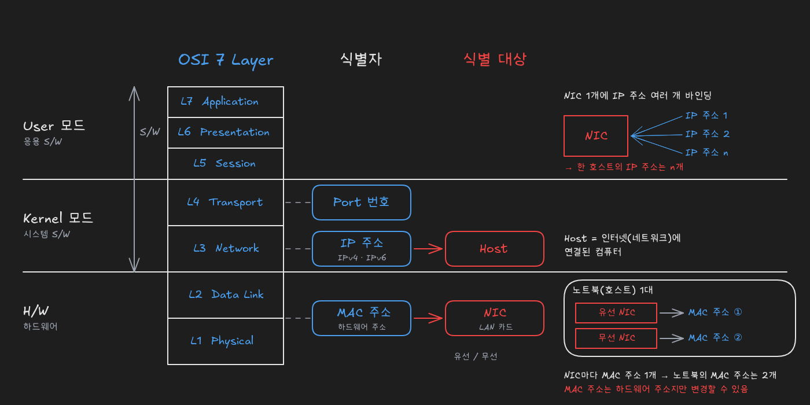
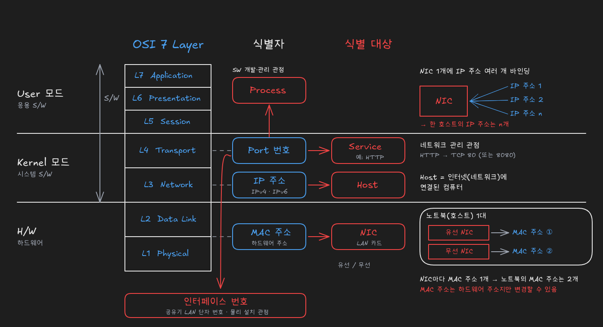

# 계층별 식별자의 식별 대상: MAC 주소, IP 주소, Port 번호

> 출처: [MAC주소, IP주소, Port번호가 식별하는 것 (YouTube)](https://www.youtube.com/watch?v=JDh_lzHO_CA)

## 계층별 식별자: Port 번호, IP 주소, MAC 주소

OSI 7 Layer를 컴퓨터의 3계층(User 모드, Kernel 모드, H/W)에 맞춰 그리면 **L1~L3이 네트워크**, **L4가 전송(Transport) 계층**에 해당합니다. 이 중 Kernel 모드에 있는 L4·L3과 H/W에 있는 아래 계층에는 각각 중요한 **식별자**가 있습니다.

| 계층 | 위치 | 식별자 |
|---|---|---|
| **L4 전송(Transport)** | Kernel 모드 | **Port 번호** |
| **L3 네트워크(Network)** | Kernel 모드 | **IP 주소** (IPv4와 IPv6가 함께 쓰이고 있음) |
| **L2 이하 하드웨어 수준** | H/W | **MAC 주소** (하드웨어 주소) |

세 가지가 모두 식별자라면, 다음으로 답해야 할 질문은 "**각 식별자는 무엇을 식별하는가?**"입니다. 답을 정리하면 **MAC 주소는 NIC**, **IP 주소는 Host**를 식별하고, **Port 번호는 바라보는 관점에 따라 Process, Service, 인터페이스 번호**로 식별 대상이 달라집니다.

## MAC 주소: NIC(LAN 카드)의 식별자

**MAC 주소는 NIC(Network Interface Card)에 대한 식별자**입니다. NIC는 흔히 **LAN 카드**라고 부르는 장치이며, **유선 LAN 카드**와 **무선 LAN 카드**가 모두 여기에 해당합니다. LAN 카드라면 유선이든 무선이든 **모두 MAC 주소를 하나씩** 갖고 있습니다.

그래서 MAC 주소의 개수는 컴퓨터 대수가 아니라 **NIC 개수**를 따라갑니다. 예를 들어 노트북 한 대에 유선 LAN 카드와 무선 LAN 카드가 모두 있으면, 이 노트북은 NIC가 2개이므로 **MAC 주소도 2개**입니다. 즉 NIC는 호스트 자체가 아니라 **호스트에 장착된 부품**이고, MAC 주소는 그 부품에 붙는 식별자입니다. NIC는 보통 자주 바꾸는 부품이 아니므로 MAC 주소도 자주 바뀌지 않습니다. 다만 USB 무선 LAN 카드처럼 쉽게 꽂고 빼는 장치는 상황이 달라질 수 있습니다.

MAC 주소는 **하드웨어 주소**라고도 부릅니다. 그런데도 **MAC 주소는 변경할 수 있습니다.** 하드웨어에 새겨진 주소라고 해서 칩을 교체해야만 바꿀 수 있는 것은 아니며, MAC 주소가 변경 가능하다는 사실은 반드시 기억해야 할 중요한 내용입니다.

## IP 주소: 호스트의 식별자

**IP 주소는 호스트(Host)에 대한 식별자**입니다. **호스트는 인터넷(네트워크)에 연결된 컴퓨터**를 말합니다. 같은 컴퓨터라도 네트워크에 연결되지 않은 상태라면 그냥 컴퓨터나 PC라고 부르고, **인터넷에 연결되어 있을 때 특별히 호스트**라고 부릅니다. 핵심은 '네트워크에 연결되어 있다'는 조건입니다.

그렇다면 컴퓨터 한 대의 IP 주소는 몇 개일까요? 답은 **n개**입니다. 유선이든 무선이든 LAN 카드가 하나뿐이면 IP 주소도 하나일 것 같지만, **NIC 하나에 IP 주소를 여러 개 연결**할 수 있습니다. 이렇게 NIC에 IP 주소를 연결하는 것을 매핑보다는 주로 **바인딩**(binding)이라고 표현합니다. NIC 하나에 IP 주소 1을 바인딩하고, 또 다른 IP 주소 2를 함께 바인딩해 쓸 수 있으므로 **컴퓨터 한 대가 여러 개의 IP 주소**를 가질 수 있습니다.

| 식별자 | 식별 대상 | 개수 관계 |
|---|---|---|
| **MAC 주소** | **NIC** (LAN 카드) | NIC 1개에 MAC 주소 1개 → NIC가 2개인 노트북은 MAC 주소 2개 |
| **IP 주소** | **Host** (인터넷에 연결된 컴퓨터) | NIC 1개에 IP 주소 여러 개 바인딩 가능 → 호스트 1대에 IP 주소 n개 |

## Port 번호: 관점에 따라 달라지는 식별 대상

MAC 주소와 IP 주소는 식별 대상이 분명한 반면, **Port 번호는 어떤 일을 하는 사람이 바라보느냐에 따라 식별 대상이 달라집니다.** 그래서 "Port 번호는 무엇에 대한 식별자인가?"에 대한 대답을 들으면 그 사람이 어떤 업무를 하는지 어느 정도 알 수 있습니다.

| 관점 | 주로 일하는 계층 | Port 번호의 식별 대상 |
|---|---|---|
| **소프트웨어 개발·관리** | User 모드 애플리케이션 | **Process** |
| **네트워크 관리** | Kernel의 L4(전송 계층) | **Service** |
| **물리적 네트워크 설치·통신 공사** | H/W | **인터페이스 번호** |

**User 모드 애플리케이션**, 즉 소프트웨어를 개발하거나 관리하는 사람은 Port 번호를 **Process의 식별자**로 이해합니다.

**네트워크 관리자**처럼 L4 전송 계층에 속한 일을 주로 하는 사람은 Port 번호를 **Service의 식별자**로 봅니다. 예를 들어 웹에서 쓰는 **HTTP는 보통 TCP 80번 포트**를 쓰지만, **8080번**처럼 다른 번호를 쓰는 경우도 있습니다. 그래서 실무에서는 "80번 포트를 열어 주세요"보다 "**HTTP 서비스를 열어 주세요**"라고 많이 말하고, 네트워크 관리자에게 Port 번호는 곧 서비스를 가리키는 식별자가 됩니다.

**물리적으로 네트워크를 설치하고 통신 공사를 하는 사람**은 Port 번호를 **인터페이스 번호**로 떠올립니다. 공유기 뒷면의 유선 LAN 케이블 단자마다 붙어 있는 번호가 바로 이들이 생각하는 포트 번호입니다.

이처럼 같은 'Port 번호'라는 단어도 처한 상황과 업무에 따라 **인터페이스 번호**, **Service**, **Process의 식별자**로 바뀌어 쓰입니다. MAC 주소와 IP 주소와 달리 **Port 번호는 식별 대상이 관점에 따라 달라진다**는 점을 명확히 기억해야 합니다.

## 복습 질문

- MAC 주소는 무엇을 식별하나요?
  - NIC(Network Interface Card), 즉 LAN 카드를 식별합니다. 유선·무선 LAN 카드 모두 각각 MAC 주소를 가지므로, MAC 주소는 컴퓨터가 아니라 컴퓨터에 장착된 NIC라는 부품에 붙는 식별자입니다.
- 유선 LAN 카드와 무선 LAN 카드가 모두 있는 노트북의 MAC 주소는 몇 개인가요?
  - 2개입니다. MAC 주소는 NIC마다 하나씩 붙기 때문에, NIC가 2개인 노트북은 MAC 주소도 2개입니다.
- MAC 주소는 하드웨어 주소이므로 바꿀 수 없나요?
  - 아니요, 변경할 수 있습니다. 하드웨어 주소라고 부르지만 칩을 교체하지 않고도 MAC 주소를 바꿀 수 있습니다.
- IP 주소는 무엇을 식별하나요?
  - 호스트(Host)를 식별합니다. 호스트는 인터넷(네트워크)에 연결된 컴퓨터를 뜻하며, 네트워크에 연결되어 있다는 조건이 핵심입니다.
- 컴퓨터와 호스트는 어떻게 구분하나요?
  - 네트워크 연결 여부로 구분합니다. 같은 컴퓨터라도 인터넷에 연결되어 있을 때 특별히 호스트라고 부르고, 연결되지 않은 상태라면 그냥 컴퓨터나 PC라고 부릅니다.
- NIC가 하나뿐인 컴퓨터는 IP 주소도 하나뿐인가요?
  - 아니요, n개일 수 있습니다. NIC 하나에 IP 주소를 여러 개 바인딩할 수 있으므로, NIC가 하나여도 컴퓨터 한 대가 여러 IP 주소를 가질 수 있습니다.
- MAC 주소와 IP 주소의 개수 관계는 어떻게 다른가요?
  - MAC 주소는 NIC 1개에 1개로 NIC 개수를 따라가고, IP 주소는 NIC 1개에 여러 개를 바인딩할 수 있어 호스트 1대에 n개가 될 수 있습니다.
- Port 번호는 무엇을 식별하나요?
  - 관점에 따라 다릅니다. 소프트웨어 개발·관리 관점에서는 Process, 네트워크 관리 관점에서는 Service, 물리적 네트워크 설치 관점에서는 공유기 단자 같은 인터페이스 번호를 식별합니다.
- 네트워크 관리자가 "80번 포트를 열어 주세요"보다 "HTTP 서비스를 열어 주세요"라고 말하는 이유는 무엇인가요?
  - Port 번호를 서비스의 식별자로 보기 때문입니다. HTTP는 보통 TCP 80번을 쓰지만 8080번을 쓰기도 하므로, 번호보다 서비스 이름으로 말하는 편이 의도를 정확히 전달합니다.
- Port 번호가 MAC 주소·IP 주소와 다른 점은 무엇인가요?
  - 식별 대상이 하나로 고정되지 않는다는 점입니다. MAC 주소는 NIC, IP 주소는 Host로 대상이 분명하지만, Port 번호는 업무와 상황에 따라 Process, Service, 인터페이스 번호로 대상이 바뀝니다.
