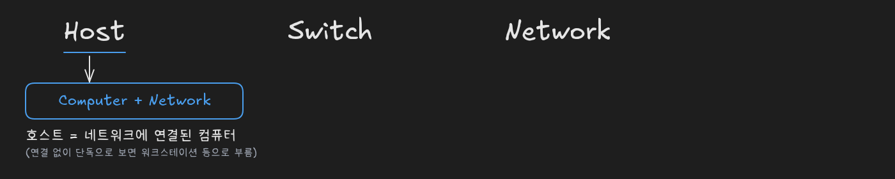
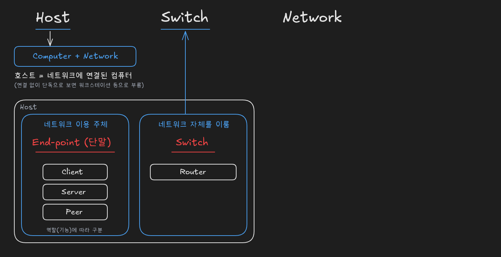
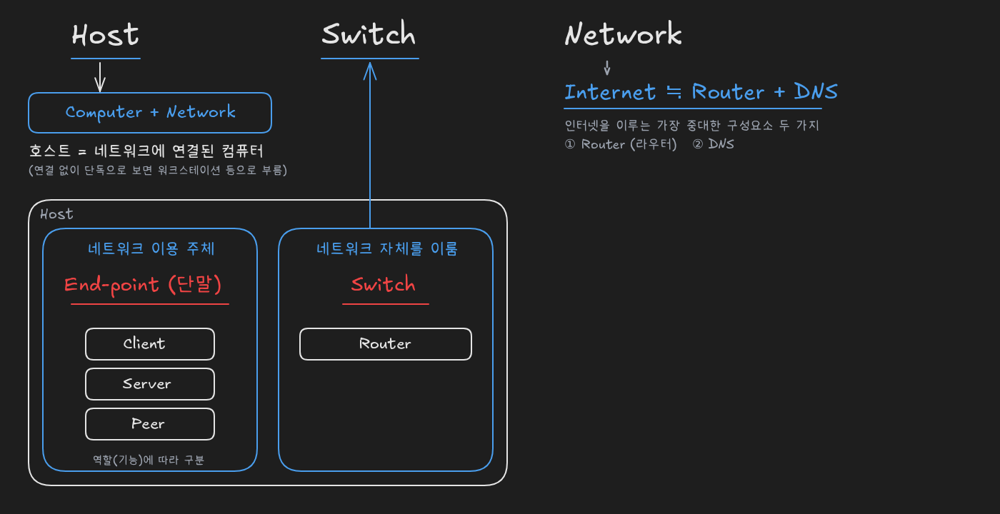
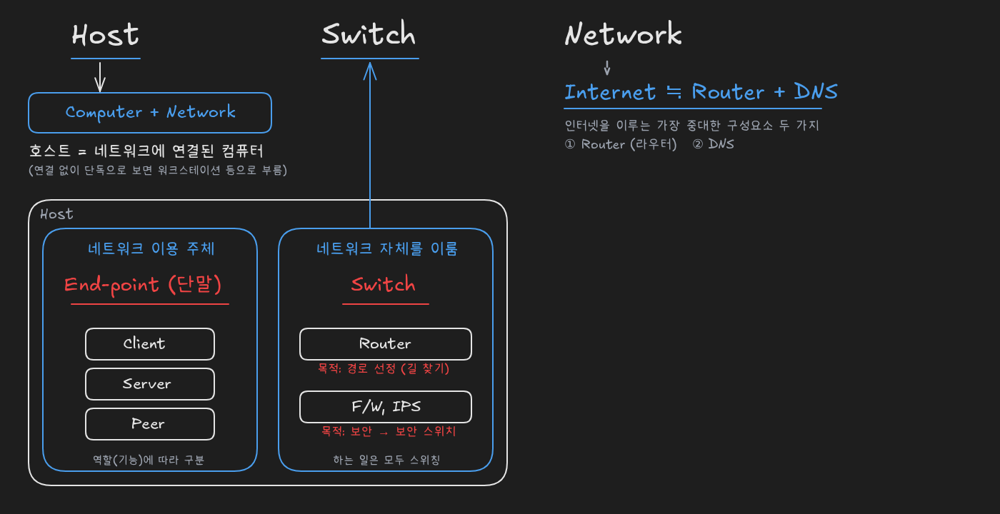
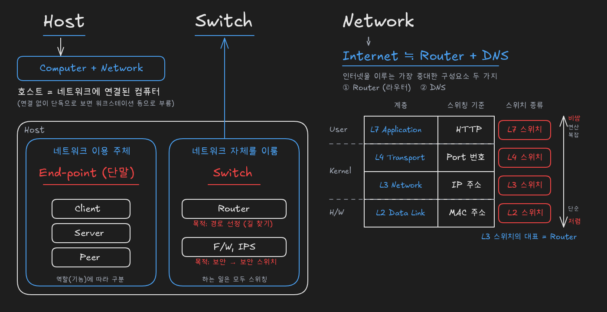
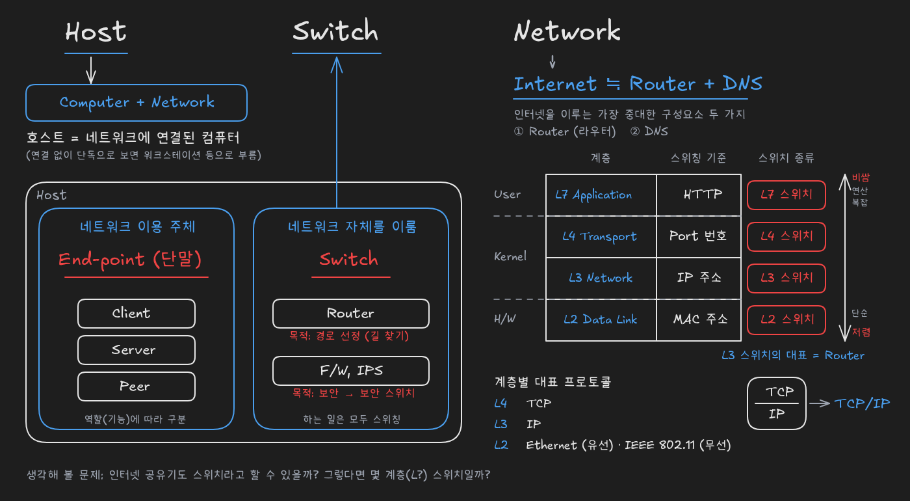

# Host, Switch, Network의 관계: 엔드포인트, 스위치, 계층별 스위칭

> 출처: [Host, Switch, Network 이들의 관계에 대해... (YouTube)](https://www.youtube.com/watch?v=kGst-VftN1w)

## 호스트: 네트워크에 연결된 컴퓨터

**호스트**(Host)는 네트워크를 공부할 때 가장 중요한 단어 중 하나입니다. 호스트는 기본적으로 **컴퓨터**이며, 그 컴퓨터가 **네트워크에 연결되어 있을 때** 특별히 호스트라고 부릅니다. 즉 **호스트 = Computer + Network**입니다.

같은 컴퓨터라도 네트워크와 떼어 놓고 그 기계만 생각할 때는 워크스테이션 같은 이름으로 부를 수 있습니다. 인터넷이든 다른 네트워크든 **네트워크에 연결되는 순간** 그 컴퓨터는 호스트가 됩니다. 핵심 조건은 '네트워크에 연결되어 있다'는 점입니다.

## 호스트의 두 분류: 엔드포인트와 스위치

호스트는 네트워크를 기준으로 크게 두 가지로 나눠 생각할 수 있습니다. 하나는 **네트워크를 이용하는 이용 주체**로서의 호스트이고, 다른 하나는 **네트워크 자체를 이루는** 호스트입니다. 네트워크는 기본적으로 **인프라스트럭처**(infrastructure)이므로, 이 인프라를 구성하는 쪽과 인프라를 사용하는 쪽으로 나뉜다고 이해하면 됩니다.

| 구분 | 이름 | 예 |
|---|---|---|
| **네트워크 이용 주체** | **End-point** (엔드포인트, 단말) | Client, Server, Peer |
| **네트워크 자체를 이룸** | **Switch** (스위치) | Router 등 |

네트워크를 이용하는 주체인 호스트는 **엔드포인트**(End-point)라고도 부릅니다. 우리말로는 끝에 있다는 뜻의 **단말**이며, 흔히 말하는 단말기가 여기에 해당합니다. 엔드포인트는 네트워크에서 맡는 **역할(기능)에 따라** 다시 **클라이언트**(Client)와 **서버**(Server)로 나누는 경우가 가장 흔하고, 클라이언트·서버라는 구분 없이 대등하게 존재하면 **피어**(Peer)라고 부릅니다.

**네트워크 자체를 이루는 호스트는 스위치**(Switch)라고 부릅니다. 즉 스위치도 네트워크에 연결된 컴퓨터, 곧 호스트의 한 종류입니다. 네트워크 자체를 이루는 스위치의 대표적인 예가 **라우터**(Router)입니다.

## 인터넷: 라우터와 DNS의 집합체

여러 네트워크 중 가장 유명한 네트워크는 **인터넷**(Internet)입니다. 인터넷을 이루는 구성요소는 매우 많지만, 가장 중대한 두 가지만 고르면 **라우터**(Router)와 **DNS**입니다. 그래서 **인터넷 ≒ 라우터 + DNS**, 즉 **인터넷은 라우터와 DNS의 집합체**라고 이해하면 됩니다. 이를 더 줄이면 인터넷은 **라우터의 거대한 집합체**라고 할 수 있습니다. DNS가 무엇인지는 이후에 따로 다룹니다.

## 스위치의 목적: 경로 선정과 보안

라우터는 네트워크 자체를 이루는 컴퓨터, 곧 스위치입니다. **스위치가 하는 일은 스위칭**(switching)입니다. 그런데 라우터 말고도 **방화벽**(F/W, Firewall)이나 **IPS** 같은 보안 장비도 하는 일은 기본적으로 스위칭이므로, 이들도 스위치라고 말할 수 있습니다. 같은 스위치라도 **무엇을 위해 스위칭하느냐**, 즉 목적에 따라 이름이 달라집니다.

| 스위치 | 스위칭하는 목적 | 다른 이름 |
|---|---|---|
| **Router** | **경로 선정** (길 찾기) | - |
| **F/W, IPS** | **보안** | **보안 스위치** |

라우터는 **경로를 찾기 위해**, 즉 길 찾기를 위해 스위칭합니다. 라우터의 목적 자체가 **경로 선정**입니다. 방화벽과 IPS는 **보안 때문에** 스위칭하므로 다른 말로 **보안 스위치**라고 부릅니다.

## 스위칭 기준에 따른 계층별 스위치

컴퓨터를 User 모드, Kernel 모드, 하드웨어로 나눈 그림에 계층별 식별자를 대응하면, 맨 아래 하드웨어 쪽에 **MAC 주소**, 그 위 Kernel 모드에 **IP 주소**와 TCP 등의 **Port 번호**가 있고, User 모드에는 웹을 이루는 핵심 프로토콜인 **HTTP**가 있습니다. MAC 주소는 하드웨어 주소라고도 부르지만 계층으로는 **L2**(데이터 링크 계층)에 속합니다.

스위치의 이름은 **무엇을 기준으로 스위칭하느냐**에 따라 정해집니다. 스위칭 기준이 되는 식별자가 속한 계층이 곧 스위치의 계층입니다.

| 스위칭 기준 | 계층 | 스위치 |
|---|---|---|
| **MAC 주소** | L2 데이터 링크 | **L2 스위치** |
| **IP 주소** | L3 네트워크 | **L3 스위치** |
| **Port 번호** | L4 전송 | **L4 스위치** |
| **HTTP** | L7 애플리케이션 | **L7 스위치** |

MAC 주소로 스위칭하면 L2 스위치, IP 주소로 스위칭하면 L3 스위치, Port 번호로 스위칭하면 L4 스위치, HTTP를 보고 스위칭하면 L7 스위치입니다. 앞에서 본 라우터는 IP 주소로 스위칭하므로 **L3 스위치**이며, **L3 스위치의 가장 대표적인 예가 라우터**입니다. 이처럼 **스위치가 무엇을 기준으로 스위칭하는지**는 반드시 기억해야 할 중요한 내용입니다.

스위치의 가격은 **계층이 높을수록 비싸고, 낮을수록 저렴**합니다. 낮은 계층은 비교적 단순하게 전기적 신호를 처리하지만, **계층이 높을수록 처리해야 하는 연산이 복잡**해지기 때문입니다.

## TCP/IP와 계층별 대표 프로토콜

각 계층에는 대표적인 프로토콜이 있습니다. L4 전송 계층에서 가장 중요한 프로토콜은 **TCP**, L3 네트워크 계층은 **IP**입니다. 그 아래 계층에서 가장 흔한 것은 흔히 유선이라고 부르는 **이더넷**(Ethernet)과, 무선 LAN에 쓰이는 **IEEE 802.11** 계열 프로토콜입니다.

| 계층 | 대표 프로토콜 |
|---|---|
| **L4 전송** | **TCP** |
| **L3 네트워크** | **IP** |
| **L2 이하** | **Ethernet** (유선), **IEEE 802.11** (무선) |

TCP와 IP는 서로 다른 계층(L4와 L3)의 프로토콜로, TCP가 IP 위에 놓이는 관계입니다. 이 둘을 함께 부를 때 **TCP/IP**라고 쓰며, 두 이름 사이에 슬래시(/)를 넣어 표기합니다. 슬래시를 쓰는 이유를 TCP와 IP의 계층 관계와 연결해 생각해 볼 만합니다.

인터넷 공유기와 연결해 생각해 볼 문제도 있습니다. 인터넷 공유기도 스위치라고 말할 수 있을까요? 그렇다면 공유기는 어느 계층의 스위치라고 말할 수 있을까요? 지금까지 정리한 스위치의 정의(네트워크 자체를 이루는 호스트)와 스위칭 기준에 따른 계층 구분을 적용해 스스로 답해 보면 좋습니다.

## 복습 질문

- 호스트란 무엇인가요?
  - 네트워크에 연결된 컴퓨터입니다. 같은 컴퓨터라도 네트워크와 떼어 놓고 보면 워크스테이션 등으로 부르고, 네트워크에 연결되어 있을 때 호스트라고 부릅니다.
- 호스트는 네트워크를 기준으로 어떻게 나뉘나요?
  - 네트워크를 이용하는 주체와 네트워크 자체를 이루는 호스트로 나뉩니다. 이용 주체는 엔드포인트, 네트워크 자체를 이루는 호스트는 스위치라고 부릅니다.
- 엔드포인트는 무엇이고, 역할에 따라 어떻게 나뉘나요?
  - 네트워크를 이용하는 주체인 호스트로, 우리말로 단말입니다. 역할에 따라 클라이언트와 서버로 나누는 경우가 가장 흔하고, 그런 구분 없이 대등하게 존재하면 피어라고 부릅니다.
- 스위치도 호스트인가요?
  - 예. 스위치는 네트워크에 연결된 컴퓨터 중 네트워크 자체를 이루는 호스트입니다.
- 인터넷을 이루는 가장 중대한 구성요소 두 가지는 무엇인가요?
  - 라우터와 DNS입니다. 그래서 인터넷은 라우터와 DNS의 집합체, 더 줄이면 라우터의 거대한 집합체라고 이해할 수 있습니다.
- 방화벽과 IPS도 스위치라고 할 수 있나요?
  - 예. 하는 일이 기본적으로 스위칭이기 때문입니다. 보안을 목적으로 스위칭하므로 보안 스위치라고도 부릅니다.
- 라우터와 보안 스위치는 무엇이 다른가요?
  - 스위칭하는 목적이 다릅니다. 라우터는 경로 선정(길 찾기)을 위해, 방화벽·IPS 같은 보안 스위치는 보안을 위해 스위칭합니다.
- L2·L3·L4·L7 스위치는 무엇으로 구분하나요?
  - 스위칭 기준으로 구분합니다. MAC 주소로 스위칭하면 L2, IP 주소면 L3, Port 번호면 L4, HTTP면 L7 스위치입니다.
- 라우터는 몇 계층 스위치인가요?
  - L3 스위치입니다. IP 주소를 기준으로 스위칭하며, L3 스위치의 가장 대표적인 예가 라우터입니다.
- MAC 주소는 어느 계층에 속하나요?
  - L2(데이터 링크 계층)에 속합니다. 하드웨어 주소라고도 부르지만 계층으로는 L2이며, MAC 주소로 스위칭하는 장비가 L2 스위치입니다.
- 높은 계층의 스위치가 더 비싼 이유는 무엇인가요?
  - 계층이 높을수록 연산이 복잡해지기 때문입니다. 낮은 계층은 비교적 단순하게 전기적 신호를 처리하지만, 높은 계층은 더 많은 정보를 해석하는 복잡한 연산이 필요합니다.
- L4와 L3의 대표 프로토콜은 무엇이고, 함께 어떻게 표기하나요?
  - L4는 TCP, L3는 IP입니다. 서로 다른 계층의 프로토콜이므로 둘을 함께 부를 때 슬래시를 넣어 TCP/IP라고 씁니다.
- 유선과 무선 LAN의 대표 프로토콜은 무엇인가요?
  - 유선은 이더넷(Ethernet), 무선은 IEEE 802.11 계열입니다. 둘 다 IP 아래 계층에서 가장 흔히 쓰는 프로토콜입니다.
