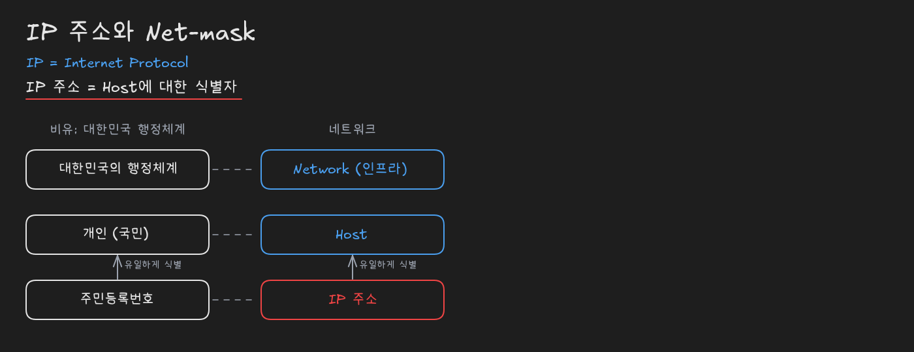
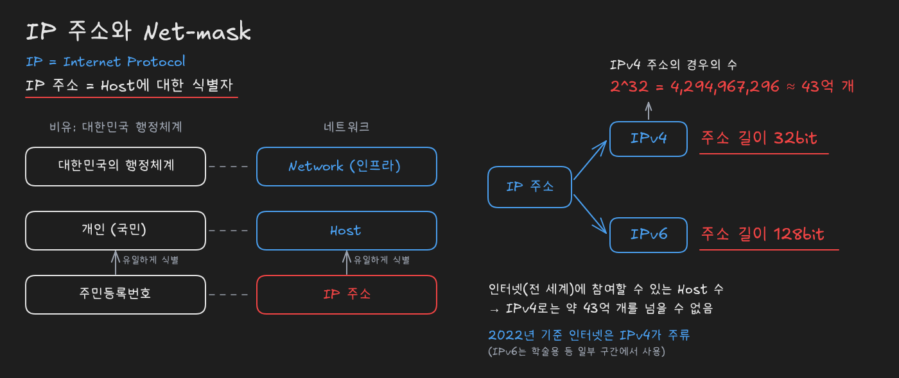
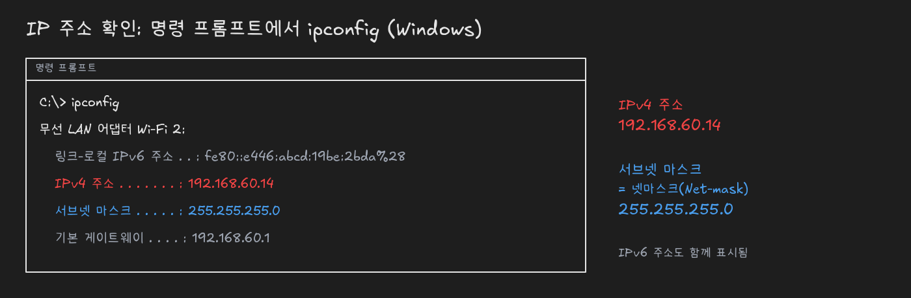
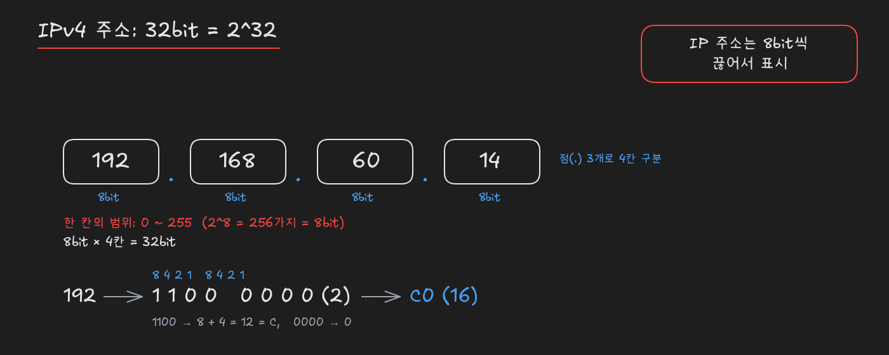
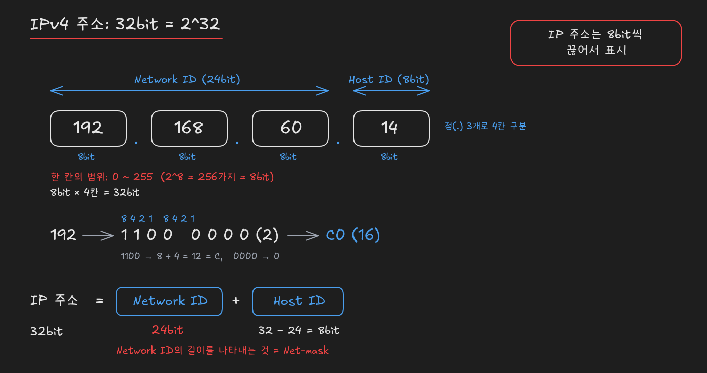
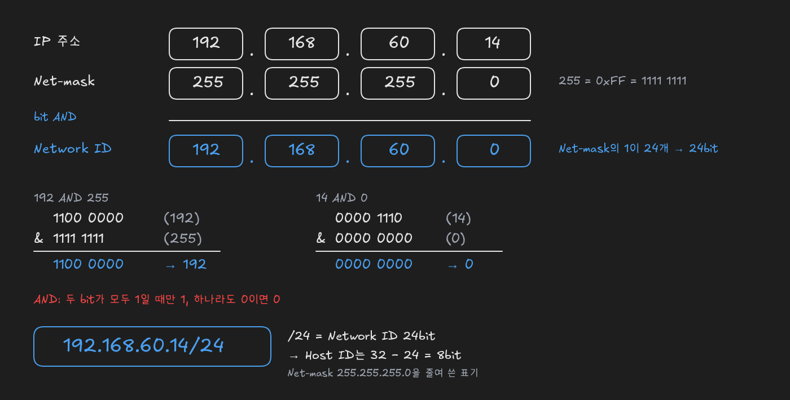

# IPv4 주소 체계: 주소 길이, 8bit 표기, Network ID와 Net-mask

> 출처: [IPv4주소 체계에 대한 암기사항 (YouTube)](https://www.youtube.com/watch?v=gOMljj6K2V0)

## IP 주소: 호스트의 식별자

**IP 주소는 호스트(Host)에 대한 식별자**입니다. 사람에 비유하면 호스트가 사람이고, IP 주소는 그 사람을 가리키는 **주민등록번호**에 해당합니다. 대한민국에는 행정체계가 있고, 그 안에서 대한민국 국민인 개인 한 사람을 **유일하게 식별**해야 할 때 주민등록번호를 씁니다. 이 구조를 네트워크에 그대로 옮기면 다음과 같이 대응합니다.

| 비유 (대한민국 행정체계) | 네트워크 |
|---|---|
| 대한민국의 행정체계 | **Network** (인프라) |
| 개인 (국민) | **Host** |
| 주민등록번호 | **IP 주소** |

즉 행정체계라는 인프라 안에서 개인을 주민등록번호로 식별하듯, 네트워크라는 인프라 안에서 호스트를 유일하게 식별하는 값이 IP 주소입니다.

**IP는 Internet Protocol의 약자**입니다. **프로토콜**(protocol)은 통신을 하기 위한 **규약·규칙**을 뜻하며, 여러 분야에서 쓰이는 말이지만 인터넷을 공부할 때는 주로 **네트워크 프로토콜**을 가리킵니다.

## IPv4와 IPv6: 주소 길이의 차이

IP 주소에는 **IPv4**와 **IPv6** 두 가지 버전이 있습니다(IPv5는 없습니다). 둘의 가장 큰 차이는 **주소 길이**입니다.

| 버전 | 주소 길이 |
|---|---|
| **IPv4** | **32bit** |
| **IPv6** | **128bit** |

"IPv4는 32bit 주소 체계, IPv6는 128bit 주소 체계"라는 사실은 네트워크를 공부할 때 반드시 기억해야 할 **최소한의 암기 대상**입니다.

주소 길이가 정해지면 만들 수 있는 주소의 개수도 정해집니다. IPv4는 32bit이므로 나올 수 있는 전체 경우의 수는 **2^32 = 4,294,967,296**, 대략 **43억 개**입니다. 이 숫자는 곧 **인터넷이라는 세계에 참여할 수 있는 호스트 수의 한계**를 뜻합니다. IP 주소는 호스트의 식별자이므로, IPv4 주소 하나당 호스트 하나를 식별한다면 전 세계 인터넷에 연결될 수 있는 호스트는 약 43억 개를 넘을 수 없습니다. 그런데 전 세계의 컴퓨터는 그보다 훨씬 많고, 한 사람이 여러 대의 기기를 쓰면 필요한 주소는 더 늘어납니다. 이론상으로는 주소가 크게 모자라지만 여러 기술 덕분에 인터넷을 문제없이 사용하고 있습니다.

2022년 기준 인터넷에서는 **IPv4를 가장 많이 사용**합니다. IPv6를 쓰는 구간도 있지만 학술적인 용도 등 일부에 그치며 일반적이지는 않습니다. 따라서 IPv4 환경에서 주소의 길이는 **32bit**라는 점을 기준으로 IP 주소를 이해하면 됩니다.

## ipconfig로 IP 주소 확인

내 컴퓨터의 IP 주소는 Windows 기준 **명령 프롬프트에서 `ipconfig`** 명령을 실행해 확인할 수 있습니다. 결과에는 네트워크 어댑터별로 다음과 같은 항목이 나옵니다.

| 항목 | 예시 값 |
|---|---|
| 링크-로컬 **IPv6 주소** | `fe80::e446:abcd:19be:2bda%28` |
| **IPv4 주소** | `192.168.60.14` |
| **서브넷 마스크** | `255.255.255.0` |
| 기본 게이트웨이 | `192.168.60.1` |

하나의 어댑터에 IPv4 주소와 IPv6 주소가 함께 표시됩니다. **서브넷 마스크**(subnet mask)는 **넷마스크**(Net-mask)라고도 많이 부르며, 뒤에서 설명할 Network ID의 길이를 나타내는 값입니다. 이후 설명은 IPv4 주소 `192.168.60.14`와 넷마스크 `255.255.255.0`을 예로 진행합니다.

## IPv4 주소의 8bit 단위 표기

IPv4 주소 `192.168.60.14`는 **점(.) 3개로 4칸이 구분**되어 있습니다. 점을 기준으로 나뉜 각 칸에 들어갈 수 있는 숫자의 범위는 **0~255**이고, 이는 **2^8 = 256가지, 즉 8bit**입니다. 8bit짜리 칸이 4개이므로 **8bit × 4 = 32bit**가 되어 IPv4의 주소 길이와 일치합니다.

정리하면 **IPv4 주소는 32bit를 8bit씩 끊어서 10진수로 표시**한 것입니다. 수십억 단위의 숫자 하나로 외우는 것보다 이렇게 나눠 적는 편이 표기와 관리에 훨씬 편리합니다.

각 칸의 10진수는 **2진수로 바꿔 생각할 줄 알아야** 합니다. 이 변환이 넷마스크를 이해하는 바탕이 됩니다. 예를 들어 첫 칸의 **192**를 2진수로 바꾸면 **1100 0000**입니다. 이를 4bit씩 나눠 각 자리에 **8·4·2·1**의 자릿값을 붙이면 16진수로도 바로 바꿀 수 있습니다. 앞의 `1100`은 8 + 4 = 12이므로 16진수 **C**이고(10=A, 11=B, 12=C), 뒤의 `0000`은 **0**이므로 192는 16진수로 **C0**입니다. Windows 계산기의 프로그래머 모드를 사용하면 10진수·2진수·16진수 변환 결과를 함께 확인할 수 있습니다.

## Network ID와 Host ID

**IPv4 주소는 크게 둘로 나뉩니다.** 앞부분을 **Network ID**, 뒷부분을 **Host ID**라고 부릅니다. `192.168.60.14`를 세 번째 칸까지 끊으면 `192.168.60`이 Network ID, 남은 `14`가 Host ID가 됩니다. 여기서 끊는 위치는 예시로 정한 것이며, 실제로 어디서 끊는지는 아래의 넷마스크가 결정합니다.

| 구분 | 예시 (`192.168.60.14`) | 길이 |
|---|---|---|
| **Network ID** | `192.168.60` | **24bit** |
| **Host ID** | `14` | 32 − 24 = **8bit** |

두 부분의 **길이 관계**도 중요합니다. IPv4 주소 전체는 항상 32bit이므로 **IP 주소(32bit) = Network ID + Host ID**가 성립합니다. 따라서 Network ID의 길이만 알면 Host ID의 길이는 자동으로 정해집니다. Network ID가 24bit이면 Host ID는 32 − 24 = **8bit**입니다.

이처럼 **IP 주소에서 Network ID의 길이를 나타내는 것이 넷마스크**(Net-mask, 서브넷 마스크)입니다.

## Net-mask와 AND 연산

넷마스크가 어떻게 Network ID를 골라내는지는 **비트 AND 연산**으로 확인할 수 있습니다. 예시 넷마스크 `255.255.255.0`에서 **255**는 16진수로 **0xFF**, 2진수로 **1111 1111**입니다. IP 주소와 넷마스크를 같은 자리의 bit끼리 **AND 연산**하면, AND는 **두 bit가 모두 1일 때만 1**이고 하나라도 0이면 0이 되므로 다음과 같은 결과가 나옵니다.

| 칸 | IP 주소 (2진수) | 넷마스크 (2진수) | AND 결과 |
|---|---|---|---|
| 첫 칸 | 192 = `1100 0000` | 255 = `1111 1111` | `1100 0000` = **192** |
| 넷째 칸 | 14 = `0000 1110` | 0 = `0000 0000` | `0000 0000` = **0** |

넷마스크가 255(모두 1)인 칸은 IP 주소의 bit가 **그대로 떨어져** 원래 값이 남습니다. 192와 255를 AND하면 1과 1은 1, 0과 1은 0이 되어 192가 그대로 나옵니다. 반대로 넷마스크가 0(모두 0)인 칸은 한쪽이 일방적으로 0이므로 IP 주소가 무엇이든 **결과가 0**이 됩니다. 14(`0000 1110`)와 0을 AND하면 `0000 0000`, 즉 0입니다.

따라서 `192.168.60.14`와 `255.255.255.0`을 AND 연산한 결과는 **192.168.60.0**이며, 이 값이 **Network ID**입니다. 넷마스크 `255.255.255.0`은 2진수로 **1이 8bit씩 세 칸 연속**으로 이어지므로 1의 개수가 8 + 8 + 8 = **24bit**이고, 이것이 Network ID의 길이가 됩니다.

넷마스크를 `255.255.255.0`처럼 매번 길게 적는 대신, IP 주소 뒤에 **슬래시(/)와 Network ID의 bit 수**를 붙여 **192.168.60.14/24**처럼 표기하기도 합니다. 이 표기만 보고도 Network ID가 **24bit**이고 Host ID가 32 − 24 = **8bit**라는 것을 바로 알 수 있습니다.

## 복습 질문

- IP 주소는 무엇을 식별하나요?
  - 호스트(Host)를 식별합니다. 행정체계라는 인프라 안에서 개인을 주민등록번호로 유일하게 식별하듯, 네트워크라는 인프라 안에서 호스트를 유일하게 식별하는 값이 IP 주소입니다.
- IP는 무엇의 약자이고, 프로토콜은 무슨 뜻인가요?
  - Internet Protocol의 약자입니다. 프로토콜은 통신을 위한 규약·규칙이며, 인터넷 분야에서는 주로 네트워크 프로토콜을 뜻합니다.
- IPv4와 IPv6의 가장 큰 차이는 무엇인가요?
  - 주소 길이입니다. IPv4는 32bit, IPv6는 128bit 주소 체계를 사용합니다.
- IPv4로 만들 수 있는 주소는 몇 개이고, 이 숫자는 무엇을 의미하나요?
  - 2^32, 약 43억 개입니다. IP 주소가 호스트의 식별자이므로, 이 숫자는 IPv4 인터넷에 참여할 수 있는 호스트 수의 한계를 뜻합니다.
- 2022년 기준 인터넷에서 주로 쓰는 IP 버전은 무엇인가요?
  - IPv4입니다. IPv6는 학술적인 용도 등 일부 구간에서만 쓰이고 일반적이지 않습니다.
- Windows에서 내 IP 주소와 넷마스크는 어떻게 확인하나요?
  - 명령 프롬프트에서 `ipconfig`를 실행합니다. 어댑터별로 IPv4 주소, IPv6 주소, 서브넷 마스크, 기본 게이트웨이가 표시됩니다.
- IPv4 주소의 점(.)으로 구분된 한 칸은 몇 bit이고, 값의 범위는 어떻게 되나요?
  - 8bit이고 범위는 0~255입니다. 2^8 = 256가지 값을 표현하므로 0부터 255까지이며, 8bit 칸 4개가 모여 32bit가 됩니다.
- 192를 2진수와 16진수로 바꾸면 어떻게 되나요?
  - 2진수 1100 0000, 16진수 C0입니다. 4bit씩 나눠 8·4·2·1 자릿값을 적용하면 1100은 8 + 4 = 12 = C, 0000은 0이 됩니다.
- IPv4 주소는 어떤 두 부분으로 나뉘나요?
  - Network ID와 Host ID로 나뉩니다. 앞부분이 Network ID, 뒷부분이 Host ID이며, `192.168.60.14`에서 Network ID가 24bit라면 `192.168.60`이 Network ID, `14`가 Host ID입니다.
- Network ID가 24bit이면 Host ID는 몇 bit인가요?
  - 8bit입니다. IPv4 주소 전체가 32bit이므로 Host ID는 32 − 24 = 8bit입니다.
- 넷마스크(서브넷 마스크)는 무엇을 나타내나요?
  - IP 주소에서 Network ID의 길이를 나타냅니다. `255.255.255.0`은 1이 24개 연속되므로 Network ID가 24bit임을 뜻합니다.
- IP 주소와 넷마스크를 AND 연산하면 무엇을 얻나요?
  - Network ID를 얻습니다. 넷마스크가 1인 bit는 IP 주소 값이 그대로 남고 0인 bit는 0이 되므로, `192.168.60.14`와 `255.255.255.0`을 AND하면 `192.168.60.0`이 나옵니다.
- 넷마스크가 255인 칸과 0인 칸에서 AND 결과는 각각 어떻게 되나요?
  - 255인 칸은 IP 주소 값이 그대로, 0인 칸은 항상 0이 됩니다. AND는 두 bit가 모두 1일 때만 1이므로, 모두 1인 255와는 원래 bit가 유지되고 모두 0인 0과는 결과가 전부 0이 됩니다.
- `192.168.60.14/24`에서 `/24`는 무엇을 뜻하나요?
  - Network ID가 24bit라는 뜻입니다. 넷마스크 `255.255.255.0`을 줄여 쓴 표기이며, 여기서 Host ID가 32 − 24 = 8bit임도 바로 알 수 있습니다.
