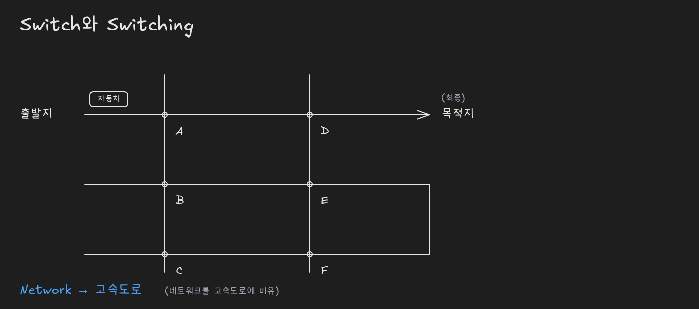
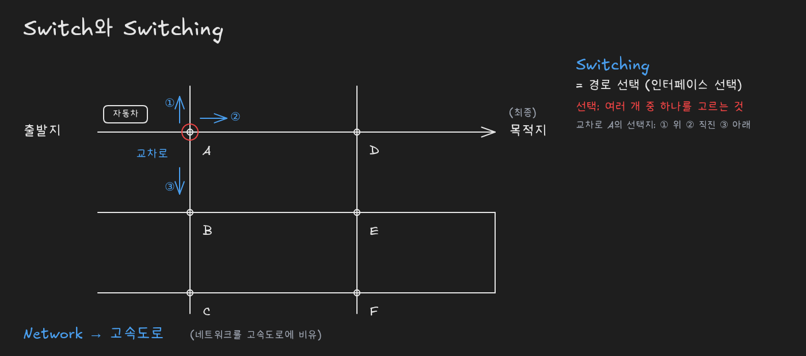
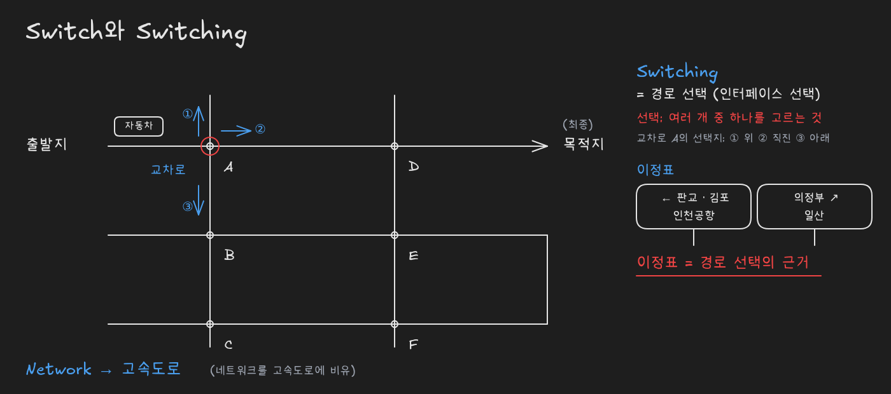
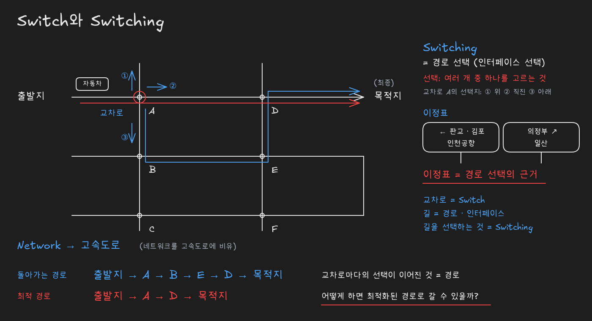
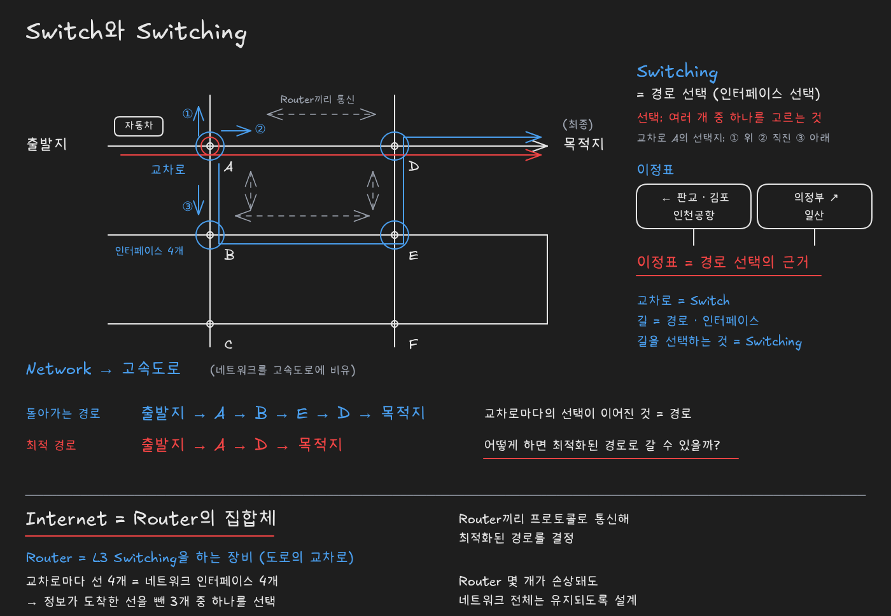
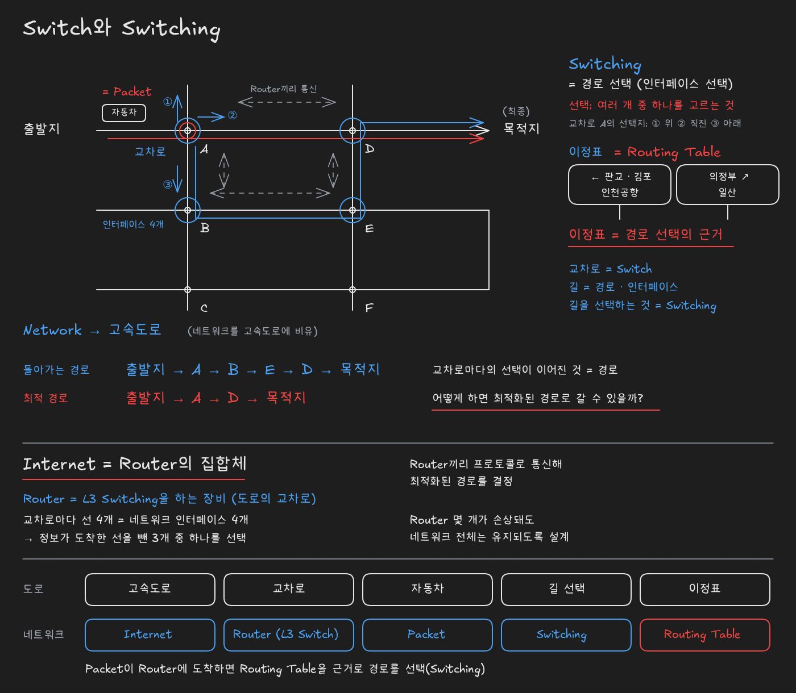

# Switch와 Switching: 경로 선택, 이정표, Router와 Routing Table

> 출처: [Switch가 하는 일은 Switching 이다. (YouTube)](https://www.youtube.com/watch?v=oAbukpZbpTg)

## 네트워크와 고속도로 비유

네트워크를 쉽게 이해하는 방법은 **네트워크를 고속도로에 비유**해 생각하는 것입니다. 도로망 위에서 자동차가 출발지에서 목적지까지 찾아가는 과정을 떠올리면, 네트워크에서 일어나는 일을 같은 구조로 설명할 수 있습니다.

이 비유의 출발점은 **Switch**입니다. Switch는 네트워크를 이루는 호스트이며, 쉽게 말해 **네트워크는 Switch로 이루어져** 있습니다. 그리고 이름 그대로 **Switch가 하는 일이 Switching**입니다. 따라서 Switching이 무엇인지 알면 네트워크가 동작하는 방식의 뼈대를 잡을 수 있습니다.

설명에 쓰는 도로망은 세로 도로 2개와 가로 도로 3개가 만나는 격자 모양입니다. 두 도로가 만나는 지점이 **A·B·C**(왼쪽 세로 도로)와 **D·E·F**(오른쪽 세로 도로) 여섯 곳이고, 맨 위 가로 도로의 왼쪽 끝이 **출발지**, 오른쪽 끝이 **최종 목적지**입니다. 자동차 한 대가 출발지에서 목적지를 향해 출발합니다.

## Switching: 경로 선택

**Switching은 경로 선택**입니다. 같은 일을 **인터페이스 선택**이라고 부를 수도 있습니다. 어느 쪽으로 부르든 핵심은 **선택**이라는 단어이고, 선택한다는 말의 대전제는 **여러 개 중 하나를 고른다**는 것입니다.

출발지를 떠난 자동차는 쭉 가다가 가장 먼저 **A 지점**을 만납니다. A든 B·C·D·E·F든 이 지점들은 모두 **교차로**입니다. 자동차는 교차로에 도착하자마자 어느 방향으로 갈지 골라야 합니다. A에서 갈 수 있는 방향은 네 가지입니다.

| 방향 | 선택지 여부 |
|---|---|
| ① 위로 올라가기 | 선택지 |
| ② 직진 | 선택지 |
| ③ 아래로 내려가기 | 선택지 |
| 뒤로 돌아가기 | 상식적으로 제외 |

온 길로 되돌아가는 경우를 빼면 **선택지는 3개**입니다. 자동차는 이 셋 중 **어디로 가야 목적지에 갈 수 있는지를 결정**해야 합니다. 교차로에서 여러 길 중 하나를 고르는 이 행위가 바로 Switching에 해당합니다.

## 이정표: 경로 선택의 근거

내비게이션 앱이나 지도가 없는 상태에서 교차로에 도착한 운전자는 **이정표**를 보고 목적지를 향해 갑니다. 이정표는 "왼쪽은 판교·김포·인천공항, 오른쪽은 의정부·일산"처럼 **어느 방향이 어느 곳으로 이어지는지**를 알려 주는 표지판입니다. 운전자는 길을 가다 이정표를 만나면 이것을 보고 왼쪽으로 갈지, 오른쪽으로 갈지, 다른 길을 고를지 결정합니다.

따라서 이정표가 갖는 의미는 **경로 선택의 근거**입니다. 교차로는 선택이 일어나는 장소이고, 이정표는 그 선택을 무엇에 기대어 내리는지를 정해 주는 기준입니다. 이정표가 나오는 지점이 기본적으로 교차로라는 점도 이 둘이 한 쌍으로 움직인다는 것을 보여 줍니다.

## 경로와 최적 경로

교차로마다 내린 선택이 이어지면 **경로**가 됩니다. 자동차가 A에서 직진해 D로 가야 하는데 아래쪽 **B로 내려갔다**고 가정합니다. 그러면 B에서 오른쪽의 E로 갔다가, E에서 위쪽의 D로 올라간 뒤에야 목적지에 도착합니다. 이때 자동차가 지나간 **출발지 → A → B → E → D → 목적지** 전체가 하나의 경로입니다. 목적지에는 도착했지만 빙 돌아간 길입니다.

이 도로 비유를 네트워크 용어로 옮기면 다음과 같습니다.

| 도로 | 네트워크 |
|---|---|
| 교차로 | **Switch** (네트워크 스위치) |
| 교차로에서 뻗은 길 | **경로** 또는 **인터페이스** |
| 길을 선택하는 것 | **Switching** |

교차로에서 어느 길을 고르느냐에 따라 결과가 크게 달라집니다. **어떤 길을 고르면 목적지에 아예 도착하지 못하고**, **어떤 길을 고르면 돌아가야** 합니다. 가장 좋은 선택은 A에서 D로 간 다음 곧바로 목적지로 가는 것입니다.

| 경로 | 거치는 교차로 | 평가 |
|---|---|---|
| 출발지 → A → B → E → D → 목적지 | 4개 | 도착은 하지만 돌아가는 길 |
| 출발지 → A → D → 목적지 | 2개 | 가장 빠르고 효율적인 길 |

**A → D → 목적지**로 가면 뱅글뱅글 도는 일 없이 길을 빨리 찾아 가장 효율적으로 목적지에 도달합니다. **어떻게 하면 이렇게 최적화된 길로 갈 수 있는가**가 네트워킹에서 가장 중요한 문제입니다. 이 단계에서 기억할 두 가지는 **Switch**와 **Switching**입니다.

## 인터넷과 Router의 L3 Switching

비유의 범위를 네트워크에서 **인터넷**으로 좁히면 교차로의 정체가 더 구체적으로 정해집니다. **인터넷은 Router의 집합체**이고, **Router는 기본적으로 L3 Switching을 수행**합니다. 그러므로 도로 전체를 인터넷이라고 하면 A·B·C 같은 **교차로는 Router**가 됩니다.

교차로 A나 B, C를 보면 그 지점을 기준으로 연결된 선이 **4개**입니다. 이 선 하나하나가 네트워크 인터페이스이므로, 이 교차로들은 모두 **네트워크 인터페이스가 4개인 Router**입니다. 어디에선가 정보가 도착하면 Router는 도착한 쪽을 뺀 **나머지 3개 중 하나를 골라** 내보내야 합니다. 이것이 Router에서 일어나는 Switching이며, 자동차가 교차로 A에서 세 방향 중 하나를 고르던 것과 같은 일입니다.

가장 효율적인 길을 찾는 방법은 **Router들끼리의 통신**에 있습니다. Router들은 가만히 있지 않고 "저쪽으로 가려면 나한테 보내는 게 유리하다", "그건 나한테 보내지 마라"와 같은 정보를 서로 주고받습니다. 이렇게 **Router들이 자기들끼리의 프로토콜로 통신해 최적화된 경로를 결정**합니다.

인터넷의 또 다른 장점은 **Router 몇 개가 손상되어도 네트워크 전체가 망가지지 않는다**는 점입니다. 그런 일이 벌어지지 않도록 안정적으로 설계되어 있습니다.

## Packet과 Routing Table

교차로가 Router라면 도로 위를 달리던 **자동차는 Packet**입니다. Packet이라는 데이터가 교차로인 Router에 도착하면 Router는 **경로 선택, 즉 Switching**을 하고, Packet은 그중 최적화된 경로를 따라 목적지로 갑니다.

이때 선택의 근거가 되던 **이정표를 네트워크에서는 Routing Table**이라고 합니다. Router는 **Routing Table을 기준으로 의사결정**을 내리고, Packet은 그 결정에 따라 목적지에 도착합니다. 경로 선택의 근거라는 점에서 Routing Table은 네트워크 동작에서 매우 중요한 의미를 갖습니다.

지금까지의 비유를 한 표로 대응시키면 다음과 같습니다.

| 도로 | 네트워크 | 설명 |
|---|---|---|
| 고속도로(도로 전체) | **Network / Internet** | 인터넷은 Router의 거대한 집합체 |
| 교차로 | **Switch / Router** | Router는 L3 Switch의 일종 |
| 자동차 | **Packet** | 목적지로 이동하는 데이터 |
| 길을 고르는 것 | **Switching** | 여러 인터페이스·경로 중 하나를 선택 |
| 이정표 | **Routing Table** | 경로 선택의 근거가 되는 의사결정 기준 |

## 복습 질문

- 네트워크를 쉽게 이해하기 위해 무엇에 비유하나요?
  - 고속도로에 비유합니다. 도로망 위에서 자동차가 교차로마다 길을 골라 목적지까지 가는 과정이 네트워크에서 데이터가 전달되는 과정과 같은 구조이기 때문입니다.
- Switch가 하는 일은 무엇인가요?
  - Switching입니다. 네트워크는 Switch로 이루어져 있고, Switch는 여러 경로 중 하나를 고르는 Switching을 수행합니다.
- Switching을 한마디로 정의하면 무엇인가요?
  - 경로 선택입니다. 인터페이스 선택이라고도 할 수 있으며, 핵심은 여러 개 중 하나를 고르는 '선택'에 있습니다.
- 교차로 A에 도착한 자동차의 선택지는 몇 개인가요?
  - 3개입니다. 위로 올라가기, 직진, 아래로 내려가기가 선택지이고, 온 길로 되돌아가는 것은 상식적으로 제외합니다.
- 이정표는 비유에서 어떤 의미를 갖나요?
  - 경로 선택의 근거입니다. 내비게이션이나 지도가 없을 때 운전자는 교차로에서 이정표를 보고 어느 길로 갈지 결정합니다.
- 도로의 교차로, 길, 길을 선택하는 행위는 네트워크에서 각각 무엇에 해당하나요?
  - 교차로는 Switch, 길은 경로 또는 인터페이스, 길을 선택하는 행위는 Switching에 해당합니다.
- A에서 B로 내려간 자동차는 어떤 경로로 목적지에 도착하나요?
  - 출발지 → A → B → E → D → 목적지 경로로 도착합니다. 목적지에는 닿지만 B와 E를 거쳐 돌아가는 길입니다.
- 가장 효율적인 경로는 무엇이고, 그 이유는 무엇인가요?
  - 출발지 → A → D → 목적지입니다. A에서 직진해 D를 지나 바로 목적지로 가므로 돌아가는 구간 없이 가장 빨리 도착합니다.
- 교차로에서의 선택에 따라 어떤 결과들이 나올 수 있나요?
  - 세 가지입니다. 목적지에 아예 도착하지 못하거나, 돌아서 도착하거나, 최적화된 경로로 바로 도착합니다. 그래서 최적화된 길을 찾는 것이 네트워킹에서 가장 중요합니다.
- 인터넷은 무엇의 집합체인가요?
  - Router의 집합체입니다. 도로 전체를 인터넷으로 보면 각 교차로가 Router에 해당합니다.
- Router는 어떤 Switching을 수행하나요?
  - L3 Switching을 수행합니다. Router는 L3 Switch의 일종입니다.
- 선이 4개 연결된 교차로를 Router로 보면 어떻게 설명할 수 있나요?
  - 네트워크 인터페이스가 4개인 Router입니다. 정보가 한 인터페이스로 도착하면 나머지 3개 중 하나를 골라 내보내며, 이 선택이 Switching입니다.
- Router들은 최적화된 경로를 어떻게 결정하나요?
  - Router들끼리 프로토콜로 통신해 결정합니다. 어느 쪽으로 보내는 것이 유리한지에 대한 정보를 서로 주고받습니다.
- Router 몇 개가 손상되면 인터넷 전체가 망가지나요?
  - 아니요, 전체는 유지됩니다. 인터넷은 일부 Router가 손상되어도 네트워크 전체가 망가지지 않도록 설계되어 있습니다.
- 비유에서 자동차는 네트워크의 무엇에 해당하나요?
  - Packet입니다. Packet이라는 데이터가 Router에 도착하면 Router가 경로를 선택해 목적지 쪽으로 보냅니다.
- 이정표를 네트워크 용어로 무엇이라고 하나요?
  - Routing Table입니다. Router는 Routing Table을 기준으로 경로 선택의 의사결정을 내립니다.
