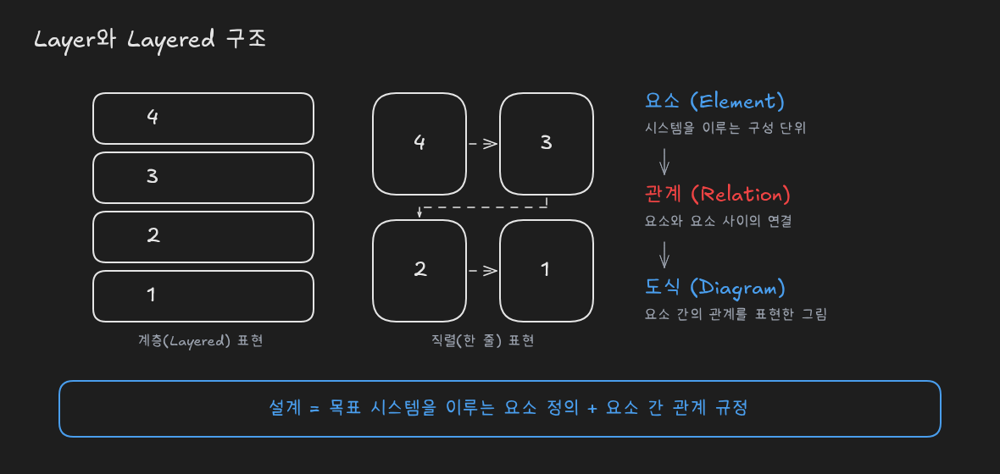
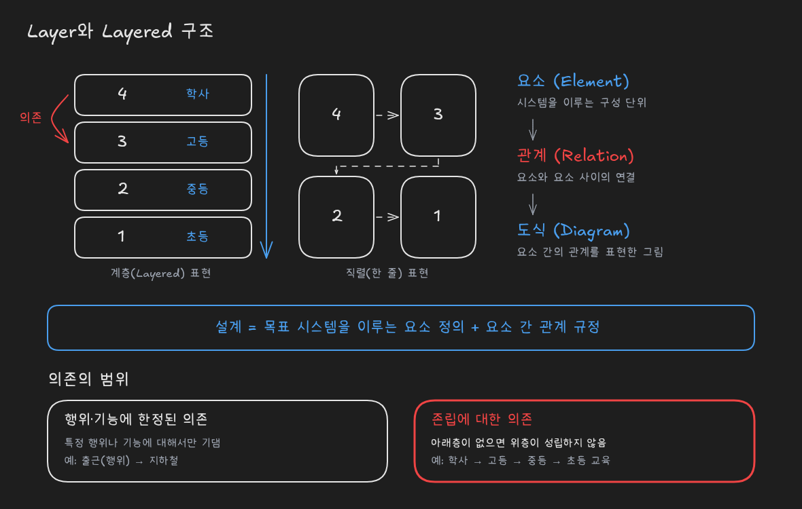
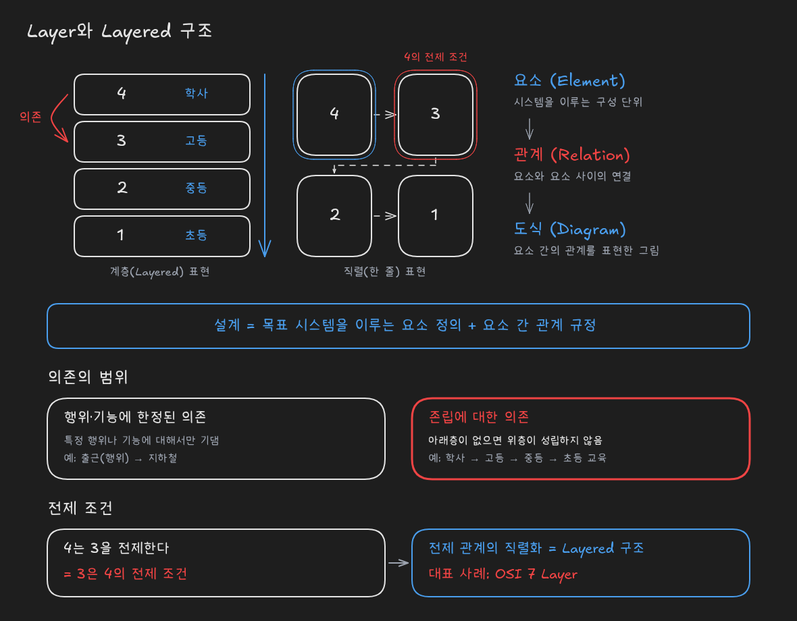

# Layer와 Layered 구조: 요소와 관계, 존립 의존, 전제 조건

> 출처: [Layer와 Layered 구조 (널널한 개발자 공식 사이트)](https://nullnull.co.kr)

## 요소와 관계: 도식과 설계

IT 기술을 공부하면 늘 만나는 그림이 **Layer**(계층)입니다. 여러 Layer가 층층이 쌓인 모양을 **Layered 구조**(계층적 구조)라고 부릅니다. 그림에서 네모 상자 하나는 **요소**(element) 하나를 뜻합니다. 1, 2, 3, 4라는 네 개의 요소가 있을 때, 이를 건물의 1층 위에 2층이 놓이듯 아래에서 위로 쌓아 그린 것이 계층적 표현입니다.

이런 그림, 곧 **도식**은 이해를 돕기 위해 매우 자주 쓰입니다. 도식을 그리는 핵심 목적은 무엇인가를 이루는 **구성 요소들 사이의 관계를 표현하는 것**입니다. 요소가 무엇인지 보여 주는 데서 그치지 않고, 요소와 요소가 서로 어떻게 이어지는지를 드러내기 위해 그림을 그립니다.

이 관점은 **설계**의 의미와 그대로 이어집니다. IT에서 설계에는 목표가 있고, 그 목표는 주로 **시스템**입니다. 큰 틀에서 설계는 다음 두 가지를 하는 일입니다.

- 목표 시스템을 이루는 **요소가 무엇인지 정의**합니다.
- 그 **요소들 사이의 관계를 규정**합니다.

설계의 정의가 이것만으로 끝나지는 않지만, 큰 틀에서는 **설계 = 요소 정의 + 관계 규정**으로 이해하면 됩니다. 요소와 관계를 정의하는 일이 그만큼 중요하기 때문에, 이를 그리기 위한 **표준화된 문법**까지 마련되어 있습니다. 따라서 어떤 도식을 보면 "요소는 무엇이고, 이 배치는 요소 사이의 어떤 관계를 말하는가"를 읽어 내야 합니다.

## 계층 구조가 표현하는 관계: 존립에 대한 의존

요소를 계층으로 쌓아 그렸을 때 그 그림이 말하는 관계는 **의존**입니다. 4층은 3층에 대해 **의존적**입니다.

'의존적이다'는 개념적인 표현이며, 의존에는 **범위**가 있습니다. 한 가지 범위는 **어떤 행위나 기능에 한정된 의존**입니다. 예를 들어 출근할 때 교통수단을 이용해 회사로 간다면, 나는 **출근이라는 행위에 한정해서 지하철에 의존**합니다. 지하철에 기대는 부분은 출근이라는 행위 하나입니다.

의존의 수준이 가장 깊어지면 **존립에 대한 의존**이 됩니다. 이때 **4는 3이 없으면 아예 성립하지 않습니다**. 학력이 좋은 예입니다. 최종 학력이 학사, 곧 4년제 대학교를 졸업했다고 말하는 순간 고등학교를 졸업했다는 사실이 확정됩니다. 고등학교를 졸업했다는 것은 중등교육을 이수했다는 것을 전제하고, 중학교를 졸업했다는 것은 초등교육을 마쳤다는 뜻입니다.

| 계층 | 학력 예시 | 성립에 필요한 아래 계층 |
|---|---|---|
| 4 | 학사(대학교 졸업) | 3 (고등) |
| 3 | 고등(고등학교 졸업) | 2 (중등) |
| 2 | 중등(중학교 졸업) | 1 (초등) |
| 1 | 초등(초등교육 이수) | 가장 아래 계층 |

이처럼 존립에 대한 의존 관계가 **직렬로, 한 줄로 이어져 성립**할 때 그림을 그리는 방법은 두 가지입니다. 4 → 3 → 2 → 1을 화살표로 이어 한 줄로 그릴 수도 있고, 4·3·2·1을 위에서 아래로 쌓아 계층으로 그릴 수도 있습니다. 두 그림은 같은 관계를 표현하며, 실제로는 **계층으로 쌓아 그리는 경우가 더 많습니다**.

그래서 IT에서 어떤 주제를 다루든 그림이 Layered 구조로 그려져 있다면 "**이 요소들은 일렬종대로 존립이 의존적이구나**"라고 읽으면 됩니다. 이 해석은 그대로 외워 둘 만한 규칙입니다.

## 전제 조건과 OSI 7 Layer

존립에 대한 의존은 **전제**라는 말로 바꿔 표현할 수 있습니다. **4는 3을 전제합니다**. 이를 반대 방향에서 말하면 **3은 4의 전제 조건**입니다. 4가 존재하려면 3이 먼저 전제되어야 합니다.

| 표현 | 방향 | 의미 |
|---|---|---|
| 4는 3에 의존한다 | 위 → 아래 | 3이 없으면 4가 성립하지 않습니다. |
| 4는 3을 전제한다 | 위 → 아래 | 4가 있다는 것은 3이 이미 있다는 뜻입니다. |
| 3은 4의 전제 조건이다 | 아래 → 위 | 3이 먼저 갖춰져야 4가 존재할 수 있습니다. |

이 전제 관계가 4와 3, 3과 2, 2와 1 사이에 차례로 이어져 **직렬화되면 Layered 구조**가 됩니다. 곧 Layered 구조는 "아래 계층이 위 계층의 전제 조건"이라는 관계가 한 줄로 이어진 구조입니다.

이 해석이 필요한 대표적인 대상이 **OSI 7 Layer**입니다. OSI 7 Layer도 이름 그대로 Layered 구조로 그려지므로, 계층이 쌓여 있다는 사실에서 "각 계층은 바로 아래 계층을 전제로 성립한다"는 관계를 먼저 읽어 낼 수 있습니다. OSI 7 Layer 자체를 깊이 파고드는 것은 우선순위가 낮으며, 그 이유는 이후 학습에서 다룹니다. 지금 단계에서 갖춰야 할 것은 Layered 구조라는 그림이 무엇을 뜻하는지 읽는 눈입니다.

## 복습 질문

- 도식에서 네모 상자 하나는 무엇을 나타내며, 도식을 그리는 핵심 목적은 무엇인가요?
  - 상자 하나는 요소 하나를 나타내고, 도식의 핵심 목적은 요소들 사이의 관계를 표현하는 것입니다. 무엇인가를 이루는 구성 요소가 있을 때, 그 요소들이 서로 어떻게 이어지는지를 보여 주기 위해 그림으로 그립니다.
- IT에서 설계는 큰 틀에서 무엇을 하는 일인가요?
  - 요소를 정의하고 요소 간의 관계를 규정하는 일입니다. 설계에는 주로 시스템이라는 목표가 있고, 그 시스템을 이루는 요소가 무엇인지 정하고 요소 사이의 관계를 정하는 것이 설계의 큰 틀입니다. 이를 표현하기 위한 표준화된 문법이 있을 정도로 요소와 관계의 정의가 중요합니다.
- 요소를 계층으로 쌓아 그린 그림은 요소 사이의 어떤 관계를 표현하나요?
  - 의존 관계, 그중에서도 존립에 대한 의존을 표현합니다. 위 계층은 아래 계층에 의존하며, 아래 계층이 없으면 위 계층이 아예 성립하지 않습니다.
- 행위·기능에 한정된 의존과 존립에 대한 의존은 어떻게 다른가요?
  - 의존하는 범위가 다릅니다. 행위·기능에 한정된 의존은 출근이라는 행위에 대해서만 지하철에 기대는 것처럼 특정 행위나 기능에만 해당합니다. 존립에 대한 의존은 의존의 수준이 가장 깊은 경우로, 의존 대상이 없으면 존재 자체가 성립하지 않습니다.
- "대학교를 졸업했다"는 말에서 고등학교 졸업이 확정되는 이유는 무엇인가요?
  - 학사 학력이 고등학교 졸업에 존립을 의존하기 때문입니다. 대학교 졸업은 고등학교 졸업을 전제하고, 고등학교 졸업은 중등교육 이수를, 중학교 졸업은 초등교육 이수를 전제합니다. 위 단계가 성립했다는 사실만으로 아래 단계가 모두 성립했음을 알 수 있습니다.
- 4 → 3 → 2 → 1을 한 줄로 이은 그림과 4·3·2·1을 쌓은 계층 그림은 서로 다른 관계를 나타내나요?
  - 아니요, 같은 관계를 나타냅니다. 둘 다 존립에 대한 의존이 직렬로 이어진 관계를 표현하며, 실제로는 계층으로 쌓아 그리는 경우가 더 많습니다.
- IT 자료에서 Layered 구조로 그려진 그림을 만나면 어떻게 해석해야 하나요?
  - 요소들이 일렬종대로 존립을 의존하는 관계라고 해석합니다. 어떤 주제의 그림이든 계층으로 쌓여 있다면 위 계층이 아래 계층 없이는 성립하지 않는다는 뜻으로 읽습니다.
- "4는 3을 전제한다"를 3의 입장에서 표현하면 어떻게 되나요?
  - "3은 4의 전제 조건이다"가 됩니다. 4가 존재하려면 3이 먼저 전제되어야 하므로, 아래 계층은 위 계층의 전제 조건입니다.
- 전제 조건과 Layered 구조는 어떤 관계인가요?
  - 전제 관계가 직렬화된 것이 Layered 구조입니다. 3이 4의 전제 조건, 2가 3의 전제 조건, 1이 2의 전제 조건이라는 관계가 한 줄로 이어질 때 이를 계층으로 쌓아 표현합니다.
- Layered 구조의 의미를 알면 OSI 7 Layer에서 무엇을 먼저 읽어 낼 수 있나요?
  - 각 계층이 바로 아래 계층을 전제로 성립한다는 관계를 읽어 낼 수 있습니다. OSI 7 Layer도 Layered 구조로 그려지므로, 세부 내용을 깊이 파고들기 전에 계층 사이의 존립 의존 관계부터 이해할 수 있습니다.
