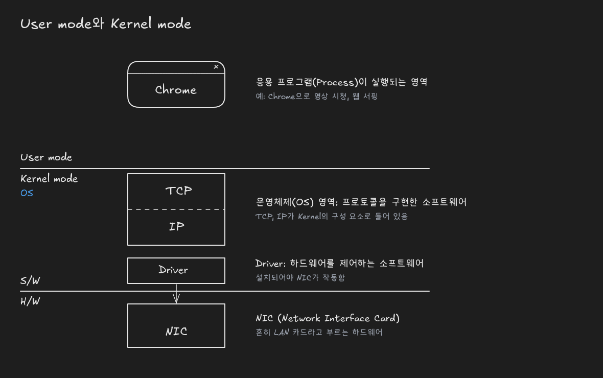
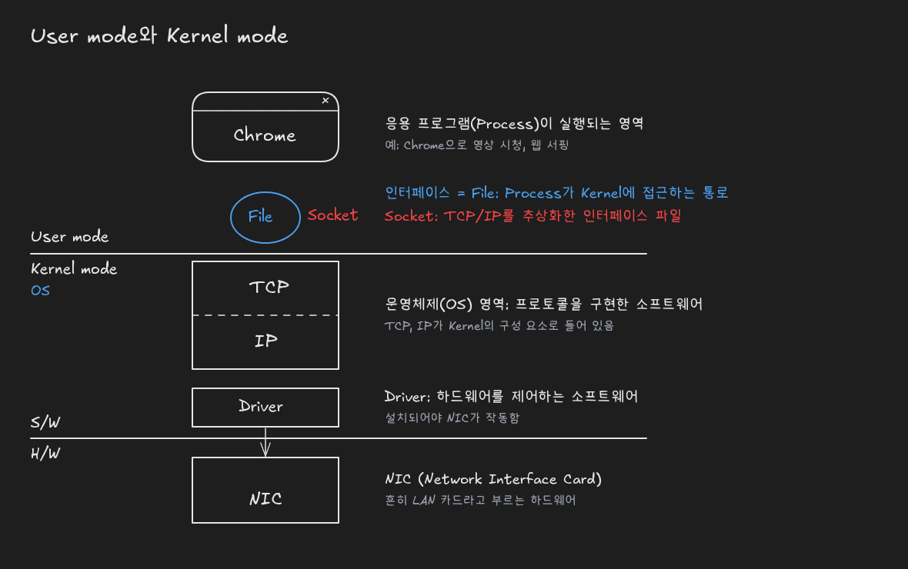
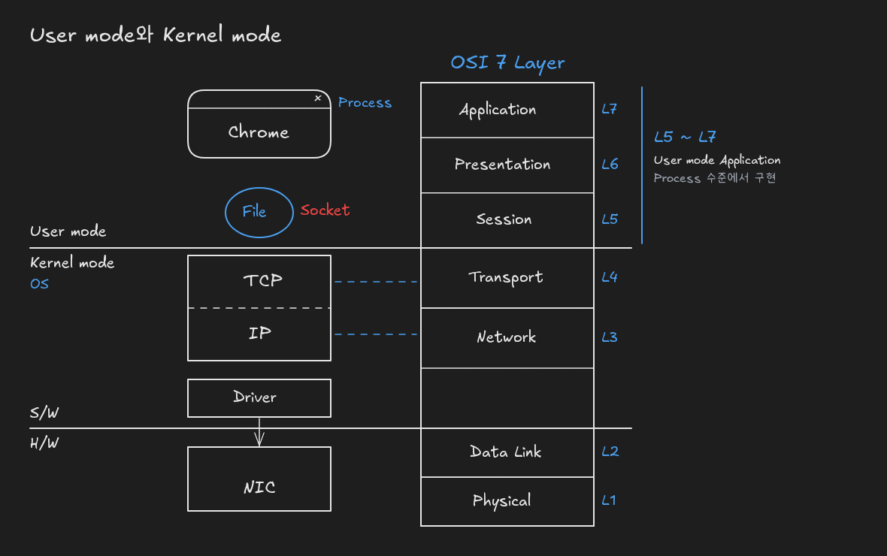
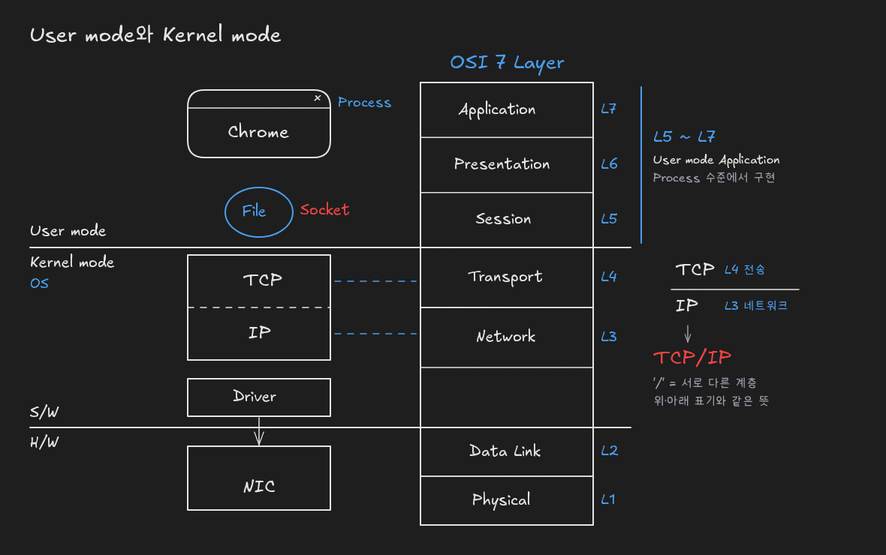
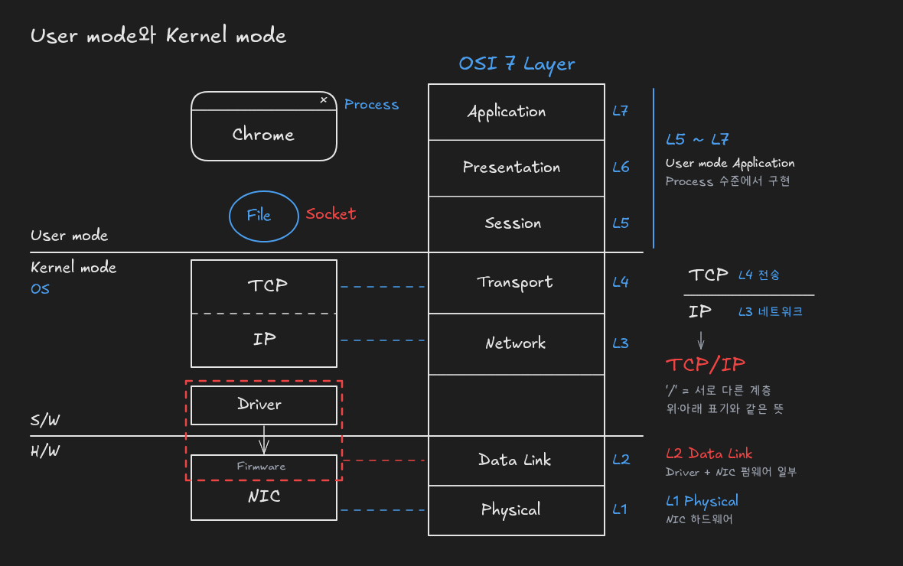
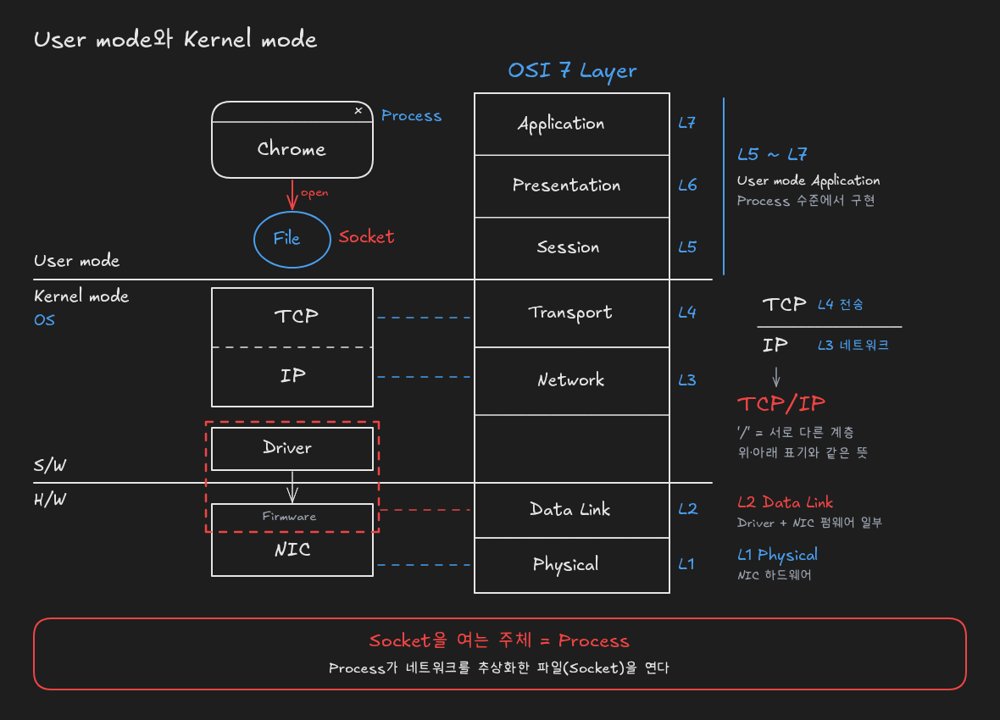

# User mode와 Kernel mode: 네트워크 구현 요소, 소켓, OSI 7 Layer 대응

> 출처: [User mode와 Kernel mode (널널한 개발자 공식 사이트)](https://nullnull.co.kr)

## 컴퓨터의 구성과 네트워크 구현 요소

컴퓨터는 **소프트웨어**(S/W)와 **하드웨어**(H/W)로 이루어지고, 소프트웨어는 다시 **User mode 애플리케이션**과 **Kernel mode 소프트웨어**로 나뉩니다. 이 세 영역에 네트워크와 관련된 요소가 하나씩 자리 잡고 있습니다.

하드웨어 영역에서 가장 관심 있게 봐야 할 장치는 **NIC**(Network Interface Card)이며, 흔히 **랜카드**라고 부릅니다. Windows를 비롯한 범용 운영체제에서는 어떤 하드웨어가 있으면 그 하드웨어를 **제어하기 위한 소프트웨어**가 함께 존재하는데, 이를 **드라이버**(Driver)라고 합니다. 랜카드를 사서 컴퓨터에 장착하거나 USB로 꽂았을 때, 드라이버가 설치되어야 그 장치가 작동합니다. 드라이버는 Kernel mode에 속하면서 하드웨어 바로 위에서 NIC를 제어합니다.

드라이버 위에는 운영체제, 곧 **커널을 이루는 구성 요소**가 있고, 여기에 **프로토콜을 구현한 소프트웨어**가 들어 있습니다. 그중 **TCP**가 위에, **IP**가 아래에 놓인 형태로 구현되어 있습니다. NIC에서 드라이버, IP, TCP까지가 하드웨어와 **운영체제 수준**의 요소입니다.

가장 위 User mode에는 **애플리케이션**이 있습니다. 닫기 버튼이 달린 창으로 실행되는 **Chrome**이 그 예이며, Chrome으로 동영상을 보거나 네이버·구글에 접속해 웹 서핑을 합니다.

| 영역 | 구성 요소 | 역할 |
|---|---|---|
| User mode (S/W) | 애플리케이션 (예: Chrome) | 사용자가 실행하는 프로그램 |
| Kernel mode (S/W) | TCP, IP | 프로토콜을 구현한 운영체제 구성 요소 |
| Kernel mode (S/W) | Driver | 하드웨어를 제어하는 소프트웨어 |
| H/W | NIC (랜카드) | 네트워크 하드웨어 |

## 커널 접근 인터페이스: 파일과 소켓

User mode 애플리케이션 프로세스가 커널의 구성 요소를 사용하려면 커널에 접근할 길이 필요합니다. 이 길은 **커널이 열어 줍니다**.

커널과 User mode의 차이는 **신계와 인간계의 차이**에 비유할 수 있습니다. 운영체제인 커널의 영역이 신계이고, 애플리케이션이 동작하는 User mode가 인간계입니다. 인간이 신의 영역에 자신의 말, 곧 **메시지**를 전하고 싶다면 **신이 정해 준 인터페이스**를 통해야 합니다. 기독교에서 기도라는 정해진 형식으로 말을 전하고 마지막에 '아멘'으로 맺는 것과 같습니다. 마찬가지로 프로세스는 커널이 정해 둔 인터페이스를 통해서만 커널의 구성 요소에 접근합니다.

이 **인터페이스는 파일(File)의 형태**로 되어 있습니다. 그리고 커널의 구성 요소 가운데 **TCP/IP를 추상화한 인터페이스 파일**은 파일이라는 일반적인 이름 대신 특별히 **소켓**(Socket)이라고 부릅니다. 그림에서 Chrome과 TCP/IP 사이, User mode와 Kernel mode의 경계 바로 위에 놓인 File이 소켓입니다.

## OSI 7 Layer와 User mode·Kernel mode의 대응

책에서 늘 보게 되는 **OSI 7 Layer**는 아래에서부터 다음과 같이 쌓여 있습니다.

| 계층 | 이름 | 구현 위치 |
|---|---|---|
| L7 | Application | User mode 애플리케이션 (프로세스) |
| L6 | Presentation | User mode 애플리케이션 (프로세스) |
| L5 | Session | User mode 애플리케이션 (프로세스) |
| L4 | Transport (전송) | Kernel mode: **TCP** |
| L3 | Network | Kernel mode: **IP** |
| L2 | Data Link | Kernel mode의 Driver + H/W의 펌웨어 일부 |
| L1 | Physical | H/W: NIC |

OSI 7 Layer는 **개념이자 관념적인 모델**이므로, 이것의 **구체적인 실체가 무엇인지**를 따져 가며 공부해야 합니다. 실체를 찾는 기준이 바로 User mode, Kernel mode, H/W의 구분입니다.

**L5부터 L7까지**, 곧 Session 위로 올라가면 그때부터는 **User mode 애플리케이션**입니다. 이 계층들은 **프로세스 수준**에서 설명되며, 어떤 프로그램이 가지고 있는 특징에 해당합니다.

**전송 계층(L4)은 운영체제에 구현**되어 있습니다. 커널의 **TCP가 전송 계층**이고, 그 아래의 **IP가 네트워크 계층**(L3)입니다. 전송 계층은 **전송의 문제**를 다루고, 네트워크 계층은 이름 그대로 **네트워크 자체**를 다룹니다.

## TCP/IP 표기의 의미

TCP와 IP의 관계를 정확히 표현하려면 **TCP를 위에, IP를 그 아래에** 써야 합니다. 구현된 모습 그대로 TCP가 IP 위에 놓이기 때문입니다. 이렇게 세로로 쓰는 것과 가로로 **TCP/IP**라고 쓰는 것은 **같은 표기**입니다.

가로로 쓸 때 사이에 **슬래시**(/)를 넣는 이유는 두 프로토콜의 **계층이 다르다는 것을 표현**하기 위해서입니다. IP는 L3이고 TCP는 L4이므로, 슬래시는 위(L4)와 아래(L3)를 가르는 경계선 역할을 합니다.

## Data Link와 Physical 계층의 구현 위치

아래 두 계층의 실체는 Driver와 NIC에서 찾을 수 있습니다. **NIC는 완벽하게 Physical 계층**에 해당하는 하드웨어입니다.

**Data Link 계층은 두 영역에 걸쳐** 있습니다. 커널의 **드라이버 영역**과 하드웨어의 **일정 수준의 펌웨어**까지를 합친 범위가 Data Link 계층입니다. 따라서 Data Link 계층은 S/W와 H/W의 경계선을 사이에 두고 위쪽의 Driver와 아래쪽 NIC의 펌웨어 부분을 함께 포함합니다.

| 계층 | 실체 | 속한 영역 |
|---|---|---|
| L2 Data Link | Driver + NIC 펌웨어 일부 | Kernel mode와 H/W에 걸침 |
| L1 Physical | NIC | H/W |

User mode와 Kernel mode라는 말은 이후 네트워크 학습에서 계속 등장하므로, 애플리케이션–File(Socket)–TCP–IP–Driver–NIC의 배치와 OSI 7 Layer의 대응을 담은 이 그림 전체를 외워 두면 도움이 됩니다.

## 소켓의 실체와 소켓을 여는 주체

**소켓의 실체는 파일**입니다. MP3 파일과 같은 종류의 파일이며, 그런 파일 가운데 특별히 **네트워크 추상화가 이루어진 파일**을 소켓이라고 부릅니다.

"소켓을 열었다", "소켓을 닫았다"라는 표현은 곧 **파일을 열고 닫았다**는 뜻입니다. 이때 소켓을 여는 **주체, 곧 문장의 주어는 프로세스**입니다. "소켓을 열었다"는 말을 정확히 풀면 "**어떤 프로세스가 어떤 소켓을, 곧 어떤 파일을 열었다**"가 됩니다. 이 관계는 반드시 외워 두어야 할 내용입니다.

## 복습 질문

- 컴퓨터는 어떤 영역으로 나뉘며, 네트워크 관련 요소는 각각 어디에 있나요?
  - H/W, Kernel mode, User mode 세 영역으로 나뉩니다. 컴퓨터는 소프트웨어와 하드웨어로 이루어지고 소프트웨어가 다시 User mode 애플리케이션과 Kernel mode 소프트웨어로 나뉩니다. H/W에는 NIC, Kernel mode에는 Driver와 TCP·IP, User mode에는 Chrome 같은 애플리케이션이 있습니다.
- 드라이버는 무엇이며, 어느 영역에 속하나요?
  - 하드웨어를 제어하기 위한 소프트웨어이며 Kernel mode에 속합니다. 랜카드를 장착하거나 USB로 꽂아도 드라이버가 설치되어야 장치가 작동합니다.
- User mode 프로세스는 커널의 구성 요소에 어떻게 접근하나요?
  - 커널이 열어 준 인터페이스를 통해 접근합니다. 신계에 말을 전하려면 신이 정해 준 형식인 기도를 통해야 하듯, 프로세스는 커널이 정한 인터페이스를 거쳐야 하며 그 인터페이스는 파일의 형태로 되어 있습니다.
- 소켓과 파일은 서로 다른 것인가요?
  - 아니요, 소켓의 실체는 파일입니다. 커널이 제공하는 인터페이스 파일 가운데 TCP/IP, 곧 네트워크를 추상화한 파일을 특별히 소켓이라고 부릅니다.
- OSI 7 Layer에서 User mode 애플리케이션에 해당하는 계층은 어디인가요?
  - L5(Session)부터 L7(Application)까지입니다. 이 계층들은 프로세스 수준에서 설명되며, 어떤 프로그램이 가지고 있는 특징에 해당합니다.
- TCP와 IP는 각각 OSI 7 Layer의 몇 계층이며, 어디에 구현되어 있나요?
  - TCP는 L4 전송 계층, IP는 L3 네트워크 계층이며 둘 다 운영체제(커널)에 구현되어 있습니다. 전송 계층은 전송의 문제를, 네트워크 계층은 네트워크 자체를 다룹니다.
- TCP/IP에서 슬래시(/)는 무엇을 의미하나요?
  - 두 프로토콜의 계층이 다르다는 것을 의미합니다. TCP는 L4, IP는 L3이므로 정확히는 TCP를 위에 IP를 아래에 써야 하며, 가로로 쓴 TCP/IP는 이 세로 표기와 같은 표기입니다.
- Data Link 계층과 Physical 계층은 구현 위치가 어떻게 다른가요?
  - Physical 계층은 NIC 하드웨어에 온전히 해당하고, Data Link 계층은 두 영역에 걸쳐 있습니다. Data Link 계층은 커널의 드라이버 영역과 하드웨어의 일정 수준 펌웨어까지를 합친 범위입니다.
- OSI 7 Layer를 공부할 때 User mode와 Kernel mode의 구분이 필요한 이유는 무엇인가요?
  - OSI 7 Layer가 관념적인 개념이어서 구체적인 실체와 연결해야 하기 때문입니다. L5 이상은 User mode 프로세스, L4·L3은 커널의 TCP·IP, L2는 Driver와 펌웨어, L1은 NIC라는 실체로 대응시키면 각 계층이 실제로 어디에 구현되는지 알 수 있습니다.
- "소켓을 열었다"는 문장의 주어는 무엇인가요?
  - 프로세스입니다. 소켓은 파일이므로 "소켓을 열었다"는 "어떤 프로세스가 어떤 파일을 열었다"는 뜻이며, 소켓을 여는 주체는 항상 프로세스입니다.
